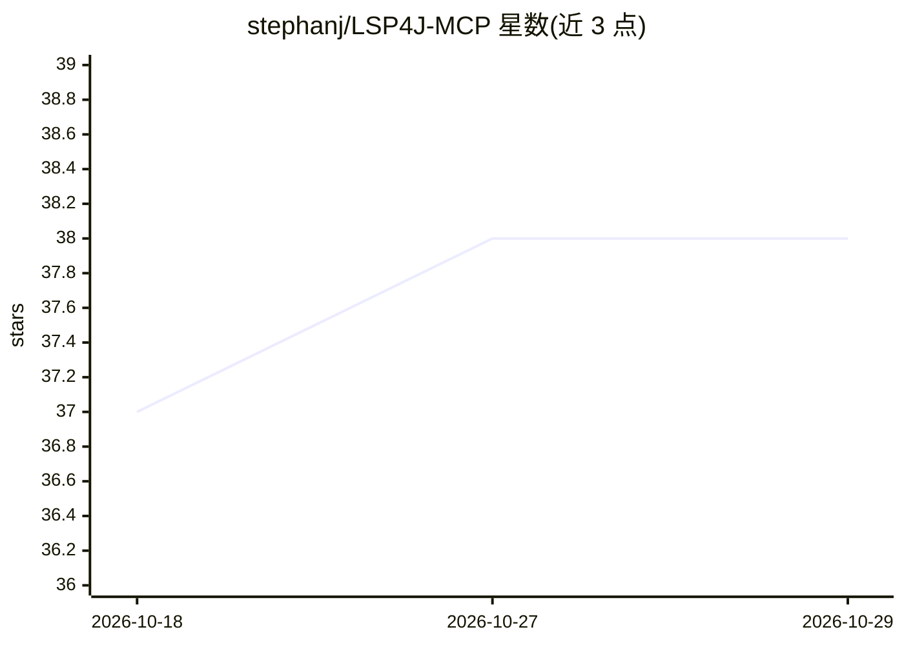

# stephanj/LSP4J-MCP

⭐ 38 · Java · 推送 2026-10-05 · [GitHub](https://github.com/stephanj/LSP4J-MCP) · 个人维护

**将 JDTLS 的 Java IDE 能力经 MCP 暴露给 AI 助手的服务器**

基于 LSP4J 封装 Eclipse JDT Language Server 的 Java MCP 服务器：以子进程方式启动 JDTLS，通过 JSON-RPC over stdio 连接，把符号查找、引用查找、跳转定义、文档符号、接口方法检索五类 LSP 能力暴露为 MCP 工具，供 Claude Code 等 AI 助手调用以理解 Java 代码库。提供 Maven 构建（shaded JAR）、run.sh 启动脚本与多阶段 Docker 镜像（内含 Java 21 与固定版本 JDTLS）。要求 Java 21+、Maven 3.8+ 与本机安装 JDTLS，容器需至少 1 GB 内存。

## 筛选速览

| 维度 | 判定 | 备注 |
|---|---|---|
| AI 角色 | `ai-ecosystem` | LLM/agent 周边工具 |
| 许可风险 | `none` | — |
| 部署形态 | `self-host` | docker 或自建部署 |
| 模型依赖 | — | README 未给出锁定关系 |
| 硬件要求 | — | 无带数字的原话,不猜 |
| 安装摩擦 | `low` | 无编译、无系统依赖或容器化 |
| 成熟度 | — | 结构信号不足 |

## 能力要点

- 五类 MCP 工具：find_symbols / find_references / find_definition / document_symbols / find_interfaces_with_method
- 以子进程启动 JDTLS 并经 LSP4J（JSON-RPC over stdio）桥接为 MCP 工具
- 提供 shaded JAR、run.sh 与含固定 JDTLS 的 Docker 镜像三种运行方式

## 适用场景

- 让 Claude Code 等 AI 助手精确定位和检索 Java 项目的符号与引用
- 重构时让 AI 助手查找某方法的所有调用处
- 以 Docker 隔离方式向 AI 助手提供 Java 代码分析能力

## 场景标签

 · 领域:开发工具/AI 编程基础设施

## 证据(README 行号)

> L3: A Java MCP (Model Context Protocol) server that wraps JDTLS (Eclipse JDT Language Server) using LSP4J to provide Jav
> L184: Claude Code ──MCP──▶ McpServerMain ──LSP4J──▶ JDTLS ──▶ Java Codebase

## 星数曲线

2026-10-18 37 → 2026-10-29 38（+1）

---
*卡片 v1 · prompt 1.4 · 生成 2026-10-25 · 置信度 high · 依据 README sha `818919c6cd46` · [字段定义](../../DATASET.md)*
