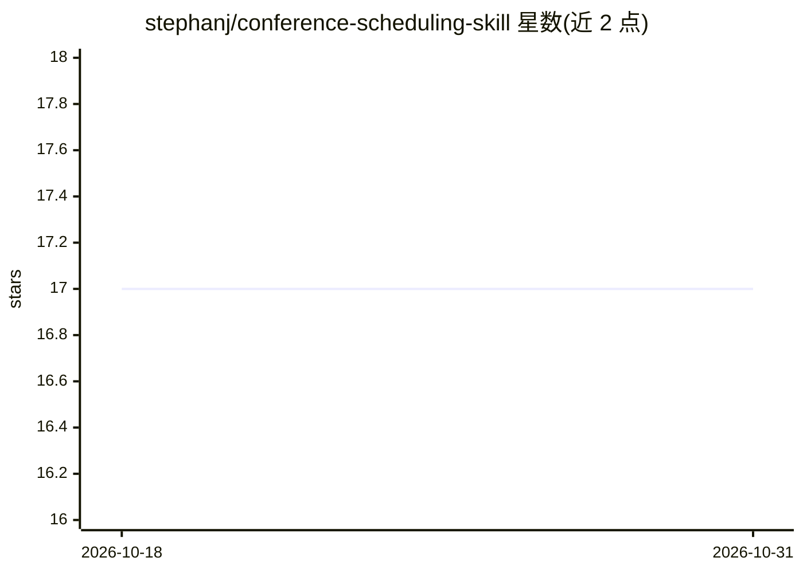

# stephanj/conference-scheduling-skill

⭐ 17 · Python · 推送 2026-03-07 · [GitHub](https://github.com/stephanj/conference-scheduling-skill) · 个人维护

**Claude Code 会议排期技能包：约束求解生成会议日程**

面向 Claude Code 的三个排期技能，分别基于 Timefold（Java）、OR-Tools CP-SAT（Python）和 SolverForge（Python），输入分号分隔的时段/房间 CSV 与演讲 CSV，在讲者冲突、房间冲突、Track 冲突、讲者可用日等硬约束下求解排期，并优化教育梯度等软约束，输出 CSV 与 Markdown 日程。安装方式为复制技能目录到 ~/.claude/skills/ 并按所选技能安装对应依赖（Java 17+/Maven 或 pip 安装 ortools/solverforge）。

## 筛选速览

| 维度 | 判定 | 备注 |
|---|---|---|
| AI 角色 | `ai-ecosystem` | LLM/agent 周边工具 |
| 许可风险 | `none` | — |
| 部署形态 | `library` | 以包/库形式分发 |
| 模型依赖 | locked-api |  |
| 硬件要求 | — | 无带数字的原话,不猜 |
| 安装摩擦 | `medium` | 含编译或系统依赖之一 |
| 成熟度 | — | 结构信号不足 |

## 能力要点

- 三个技能对应三种求解器（Timefold/OR-Tools/SolverForge），输出格式一致
- 硬约束（讲者/房间/Track 冲突、讲者可用日）+ 软约束（教育梯度、Track 固定房间）
- 支持按会议规模设定求解时限与自定义约束
- 支持基于演讲摘要 AI 分析的讲次排序

## 适用场景

- 为多日程、多 Track 的技术会议生成无冲突日程
- 在 Claude Code 中用自然语言请求排期并输出 CSV/Markdown 日程
- 添加主题演讲主会场、讲者时段偏好等自定义约束

## 场景标签

 · 领域:会议排期/约束求解

## 证据(README 行号)

> L3: Generate optimized conference schedules using constraint satisfaction solvers. These skills enable Claude Code to au
> L107: Claude Code skills are installed by copying the skill directory to your Claude Code configuration.
> L19: |`conference-scheduler-timefold-skill`|TimeFold (OptaPlanner)|Java|Advanced constraints, large conferences|

## 星数曲线

2026-10-18 17 → 2026-10-31 17（+0）

---
*卡片 v1 · prompt 1.4 · 生成 2026-10-29 · 置信度 mid · 依据 README sha `809d4e1a2edf` · [字段定义](../../DATASET.md)*
