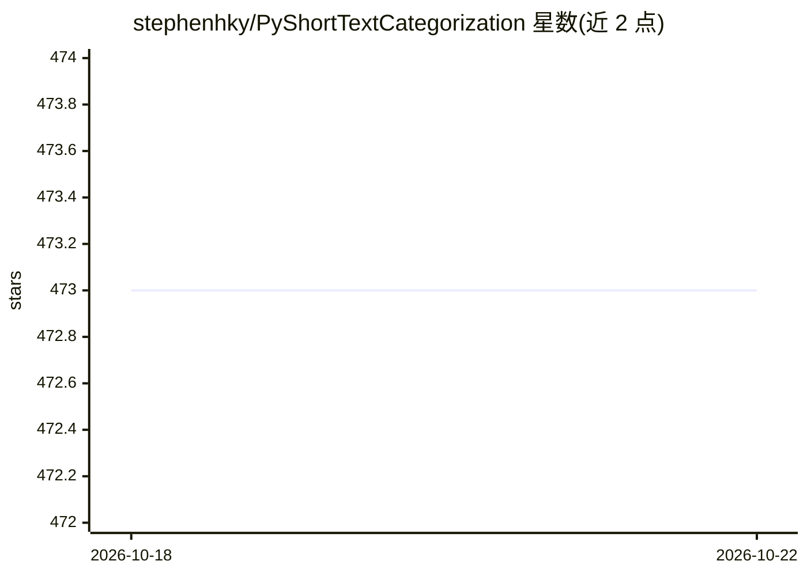

# stephenhky/PyShortTextCategorization

⭐ 473 · Python · MIT · 推送 2026-10-19 · [GitHub](https://github.com/stephenhky/PyShortTextCategorization) · [官网](https://pypi.org/project/shorttext/) · 个人维护

**Python 短文本分类与挖掘算法库，供研究开发者使用**

名为 shorttext 的 Python 包，面向短文本的监督与无监督学习：因短文本词稀疏、信息量少，包内提供多种中间表示（gensim 的 LDA/LSI/随机投影等主题模型、自编码器、预训练词向量），再接 scikit-learn 监督分类、余弦距离分类、神经网络分类（ConvNet、C-LSTM）、最大熵分类，另含字符级 seq2seq、拼写纠错与短语差异度量（soft Jaccard、Word Mover's distance）。运行于 Python 3.11-3.13，pip 安装，附文档与教程。

## 筛选速览

| 维度 | 判定 | 备注 |
|---|---|---|
| AI 角色 | `ai-native` | 本体是模型或模型工具 |
| 许可风险 | `permissive` | MIT |
| 部署形态 | `library` | 以包/库形式分发 |
| 模型依赖 | — | README 未给出锁定关系 |
| 硬件要求 | — | 无带数字的原话,不猜 |
| 安装摩擦 | `low` | 无编译、无系统依赖或容器化 |
| 成熟度 | — | 结构信号不足 |

## 能力要点

- 主题模型与词嵌入的短文本中间表示
- 多种分类器：scikit-learn 监督、余弦距离、ConvNet/C-LSTM 神经网络、最大熵
- gensim 主题模型（LDA/LSI/Random Projections）与自编码器支持
- 短语差异度量（soft Jaccard、Word Mover's distance）与拼写纠错

## 适用场景

- 对短文本（如文献关键词）做分类与主题建模
- 比较短文本相似度或差异度量
- 在文本挖掘流程中做预处理与表示学习实验

## 场景标签

 · 领域:自然语言处理/文本挖掘

## 证据(README 行号)

> L14: This package `shorttext` is a Python package that facilitates supervised and unsupervised
> L30: - neural network classification (including ConvNet, and C-LSTM);

## 星数曲线

2026-10-18 473 → 2026-10-22 473（+0）

---
*卡片 v1 · prompt 1.4 · 生成 2026-10-21 · 置信度 high · 依据 README sha `1198a61cfac5` · [字段定义](../../DATASET.md)*
