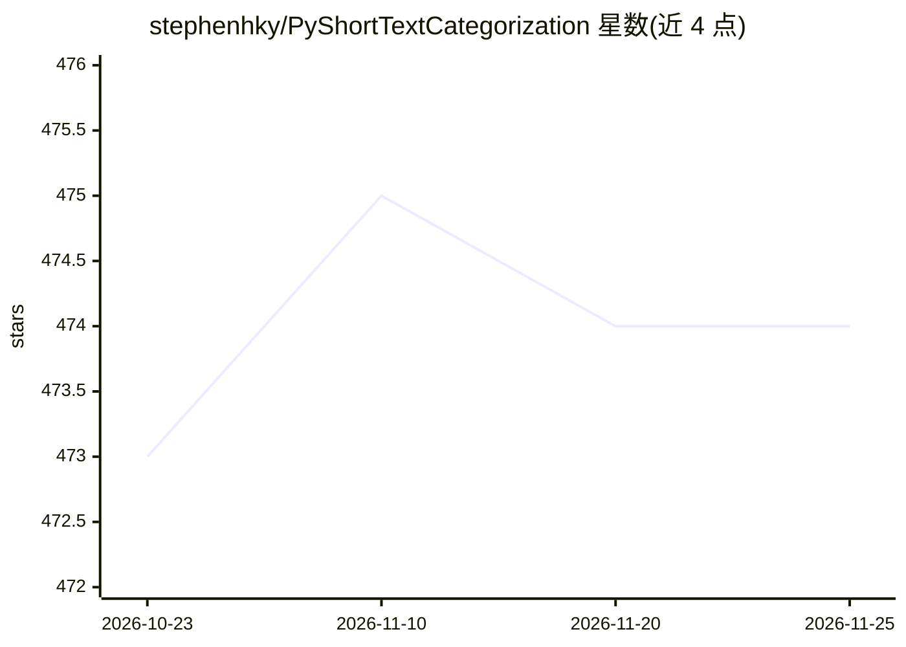

# stephenhky/PyShortTextCategorization

⭐ 474 · Python · MIT · 推送 2026-11-21 · [GitHub](https://github.com/stephenhky/PyShortTextCategorization) · [官网](https://pypi.org/project/shorttext/) · 个人维护

**短文本分类与挖掘的 Python 机器学习库**

Python 包 shorttext 支持对短文本进行监督与非监督学习：因短文本词稀疏、信息不足，库提供主题模型（gensim 的 LDA/LSI/随机投影、自编码器）与词嵌入等中间表示，再接 scikit-learn 分类、余弦距离分类、神经网络（ConvNet、C-LSTM）、最大熵分类，并提供软 Jaccard、词移距离等短语差异度量、字符级 seq2seq 学习与拼写纠正。附示例数据（NIH RePORT 等）与文本预处理，支持预训练词嵌入，运行于 Python 3.11–3.13，通过 pip 安装。

## 筛选速览

| 维度 | 判定 | 备注 |
|---|---|---|
| AI 角色 | `ai-native` | 本体是模型或模型工具 |
| 许可风险 | `permissive` | MIT |
| 部署形态 | `library` | 以包/库形式分发 |
| 模型依赖 | — | README 未给出锁定关系 |
| 硬件要求 | — | 无带数字的原话,不猜 |
| 安装摩擦 | `low` | 无编译、无系统依赖或容器化 |
| 成熟度 | — | 结构信号不足 |

## 能力要点

- gensim 主题模型（LDA/LSI/随机投影）与自编码器表示
- 神经网络分类（ConvNet、C-LSTM）与最大熵、余弦距离分类
- 软 Jaccard（Damerau-Levenshtein）与词移距离（WMD）短语度量
- 字符级 seq2seq 学习与拼写纠正，附示例数据

## 适用场景

- 对标题、关键词等短文本做主题分类
- 用词嵌入或主题模型为短文本构建中间表示
- 计算短文本间的相似度与编辑距离度量
- 对查询或标签做拼写纠正

## 场景标签

 · 领域:自然语言处理/文本挖掘

## 证据(README 行号)

> L14: This package `shorttext` is a Python package that facilitates supervised and unsupervised
> L19: of these representations, including topic modeling and word-embedding algorithms.
> L21: The package `shorttext` runs on Python 3.11, 3.12, and 3.13.

## 星数曲线

2026-10-23 473 → 2026-11-25 474（+1）

---
*卡片 v1 · prompt 1.4 · 生成 2026-11-25 · 置信度 high · 依据 README sha `2275bc3a4fda` · [字段定义](../../DATASET.md)*
