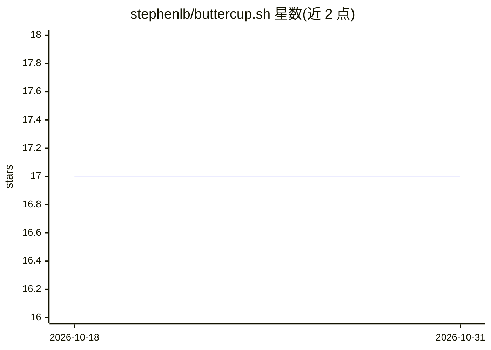

# stephenlb/buttercup.sh

⭐ 17 · JavaScript · MIT · 推送 2026-10-13 · [GitHub](https://github.com/stephenlb/buttercup.sh) · [官网](https://buttercup.sh/) · 个人维护

**浏览器内运行的编程 Agent：静态代码展示 Agent 循环机制**

用纯静态 HTML/CSS/JavaScript（经典 script 标签，无框架、构建器或依赖安装）实现的浏览器端编程 Agent harness：向所选模型发送会话与最多 23 个工具，执行工具并把结果写回对话，附带文件树、diff 视图、审批门、撤销栈与压缩机制。浏览器直连所选模型端点，无后端与遥测，密钥与文件存于 localStorage。支持 Ollama/vLLM/WebLLM 本地运行及 Anthropic/OpenAI/xAI/Google/OpenRouter 等八家网络厂商，可安装为 PWA 离线使用。配套 YouTube 课程讲解其机制，代码可读性是项目目标之一。

## 筛选速览

| 维度 | 判定 | 备注 |
|---|---|---|
| AI 角色 | `ai-native` | 本体是模型或模型工具 |
| 许可风险 | `permissive` | MIT |
| 部署形态 | `None` |  |
| 模型依赖 | local-ok | 支持本地模型 |
| 硬件要求 | — | 无带数字的原话,不猜 |
| 安装摩擦 | `low` | 无编译、无系统依赖或容器化 |
| 成熟度 | — | 结构信号不足 |

## 能力要点

- 零依赖静态实现：无服务器、无框架、无构建器，git clone 后直接打开 index.html
- 支持 9 个厂商（含 Ollama/vLLM/WebLLM 本地运行），八家网络厂商共用三种线格式
- 最多 23 个工具（读/写/编辑/编译/截图/导航等），TOOLS 面板可逐一开关
- PWA 安装，Service Worker 缓存后配合本地模型可离线运行

## 适用场景

- 在浏览器里直接使用编程 Agent 生成与修改代码
- 学习 Claude Code、Cursor 等工具背后的 Agent 循环与工具机制
- 配合 Ollama 或 vLLM 在完全本地环境运行 Agent，数据不出本机
- 通过 agent-builder 模式在 blocks.ai 上构建自己的 AI agent

## 场景标签

`编码 Agent` `教程课程` · 领域:编码与开发

## 证据(README 行号)

> L9: ButterCup is a coding agent built in the browser. Its small, dependency-free
> L17: A coding harness is a loop. It sends a conversation and a list of tools to a
> L19: file tree, diff view, approval gate, undo stack and compaction support that loop.

## 星数曲线

2026-10-18 17 → 2026-10-31 17（+0）

---
*卡片 v1 · prompt 1.4 · 生成 2026-10-29 · 置信度 high · 依据 README sha `9eab43134087` · [字段定义](../../DATASET.md)*
