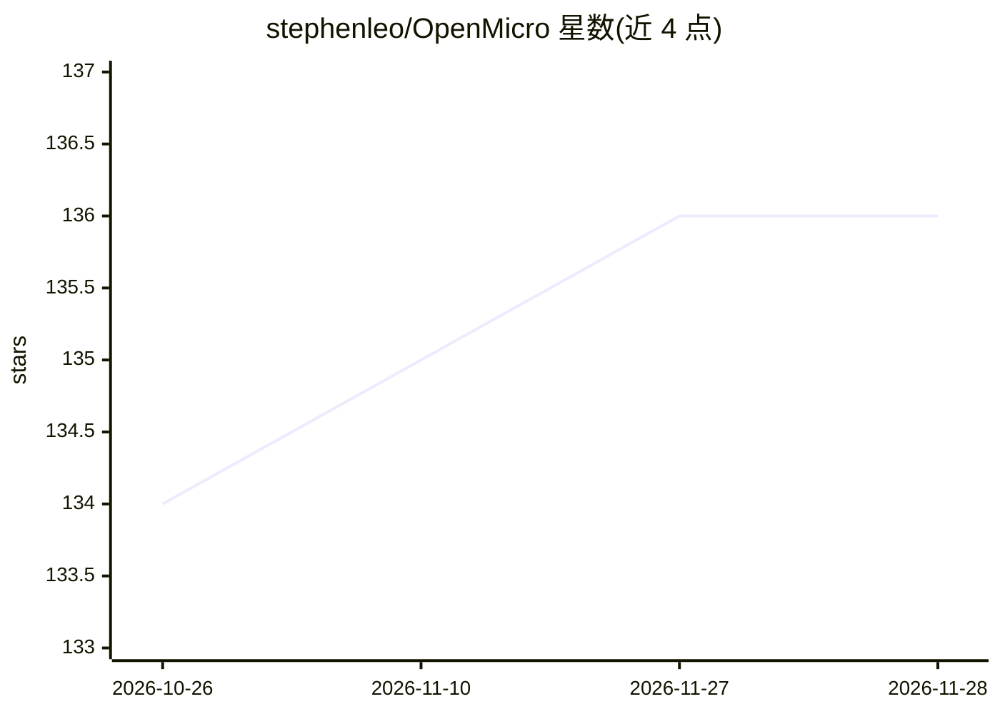

# stephenleo/OpenMicro

⭐ 136 · TypeScript · MIT · 推送 2026-11-16 · [GitHub](https://github.com/stephenleo/OpenMicro) · 个人维护

**把游戏手柄连接到 Claude Code 和 Codex CLI 的控制工具**

OpenMicro 通过 npm 全局安装，将游戏手柄按键映射为编码代理 CLI 的操作：提交/中断/新建会话、方向键导航 TUI、摇杆触发 review/debug/refactor/测试等工作流提示、右摇杆调节思考深度、按键通话语音输入。支持 DualSense 光条状态显示、六层可重映射按键、多会话焦点切换，并作为 herdr 的一等环境集成。目前 macOS 优先，其他平台未测试；语音与思考深度功能因 harness 而异。

## 筛选速览

| 维度 | 判定 | 备注 |
|---|---|---|
| AI 角色 | `ai-ecosystem` | LLM/agent 周边工具 |
| 许可风险 | `permissive` | MIT |
| 部署形态 | `library` | 以包/库形式分发 |
| 模型依赖 | — | README 未给出锁定关系 |
| 硬件要求 | — | 无带数字的原话,不猜 |
| 安装摩擦 | `low` | 无编译、无系统依赖或容器化 |
| 成熟度 | — | 结构信号不足 |

## 能力要点

- 手柄按键映射为代理操作：提交、中断、新建会话、TUI 导航
- 摇杆手势触发工作流提示与思考深度调节（六层可重映射）
- DualSense 光条实时显示会话执行/等待/完成/错误状态
- 提供 openmicro/harness 与 openmicro/controller 公开 API 供扩展

## 适用场景

- 不用切终端标签页，用手柄直接操控多个编码代理会话
- 摇杆一拨即启动 review PR、debug、重构、写测试工作流
- 在 herdr 工作区中用手柄在多个代理间切换焦点

## 场景标签

`编码 Agent` · 领域:编码与开发

## 证据(README 行号)

> L1: OpenMicro connects game controllers to Claude Code and Codex CLI
> L9: You need macOS, Node.js 22 or newer, Claude Code or Codex CLI, and a connected controller. OpenMicro is macOS-first;
> L120: Layers, workflows, navigation, and session switching are handled by OpenMicro itself. Harness-specific gaps are le

## 星数曲线

2026-10-26 134 → 2026-11-28 136（+2）

---
*卡片 v1 · prompt 1.4 · 生成 2026-11-28 · 置信度 high · 依据 README sha `8fa4ce54a2f1` · [字段定义](../../DATASET.md)*
