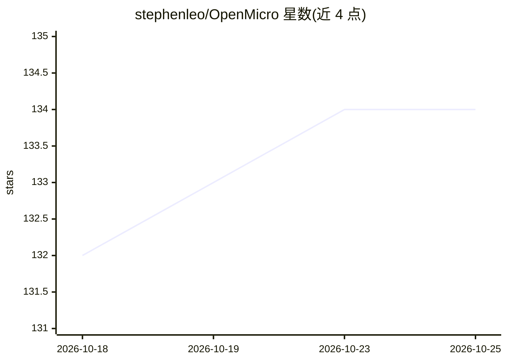

# stephenleo/OpenMicro

⭐ 134 · TypeScript · MIT · 推送 2026-08-23 · [GitHub](https://github.com/stephenleo/OpenMicro) · 个人维护

**用游戏手柄驱动 Claude Code / Codex CLI 的 macOS 控制器工具**

OpenMicro 将 DualSense、GameSir 等游戏手柄接入 Claude Code 与 Codex CLI（含 Codex 桌面 App）：按键/摇杆手势映射为提交、中断、新建会话、推杆说话、思考深度调节与 review/debug/refactor 等工作流提示；支持六个可重映射控制层、多会话切换、DualSense 灯条状态反馈，并一等集成 herdr（空间与 agent 切换）。通过 hooks 读取 agent 状态。macOS 优先，其他平台未测试；npm 全局安装。提供 harness 与控制器输入的嵌入 API。

## 筛选速览

| 维度 | 判定 | 备注 |
|---|---|---|
| AI 角色 | `ai-ecosystem` | LLM/agent 周边工具 |
| 许可风险 | `permissive` | MIT |
| 部署形态 | `library` | 以包/库形式分发 |
| 模型依赖 | — | README 未给出锁定关系 |
| 硬件要求 | — | 无带数字的原话,不猜 |
| 安装摩擦 | `low` | 无编译、无系统依赖或容器化 |
| 成熟度 | `idea` | |

## 能力要点

- 手柄按键/摇杆手势驱动 Claude Code 与 Codex CLI 的完整交互
- 六个可重映射控制层与 stick 触发的工作流提示（review/debug/refactor/测试）
- DualSense 灯条跟随会话状态（执行/等待/停止/错误）
- herdr 一等集成：空间切换、agent 轮换与状态上报

## 适用场景

- 用一只手柄在多个终端会话间切换并响应 agent
- 摇杆一键触发 review/debug/refactor 等编码工作流
- 在 herdr 工作区中用手柄切换空间与 agent

## 场景标签

 · 领域:开发者工具/agent 交互

## 证据(README 行号)

> L1: OpenMicro connects game controllers to Claude Code and Codex CLI
> L9: You need macOS, Node.js 22 or newer, Claude Code or Codex CLI, and a connected controller. OpenMicro is macOS-first;
> L77: |Capability|Claude Code|Codex CLI|

## 星数曲线

2026-10-18 132 → 2026-10-25 134（+2）

---
*卡片 v1 · prompt 1.4 · 生成 2026-10-22 · 置信度 high · 依据 README sha `d9a0dd7da014` · [字段定义](../../DATASET.md)*
