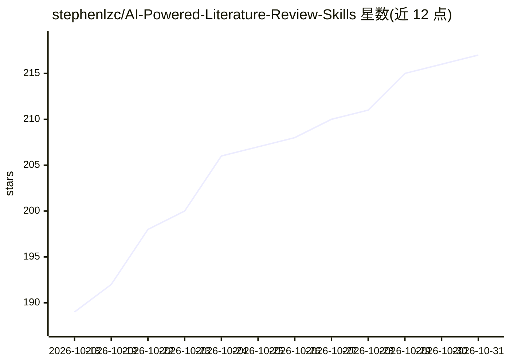

# stephenlzc/AI-Powered-Literature-Review-Skills

⭐ 217 · Python · MIT · 推送 2026-09-07 · [GitHub](https://github.com/stephenlzc/AI-Powered-Literature-Review-Skills) · 个人维护 · 中文 README

**面向科研用户的系统性文献综述 Skill：8阶段工作流自动检索与撰写综述**

为 Kimi CLI 等 AI 编程工具设计的 Skill 插件，通过浏览器自动化访问 CNKI、Web of Science、ScienceDirect、PubMed 等数据库检索文献，无需 API 配置。工作流含 8 个阶段：AI 生成检索策略、并行检索、去重、元数据验证、单篇分析、GB/T 7714-2015 引用格式化，最终按大纲→撰写→6维度审查→润色的迭代机制生成 3000-5000 字综述。必须依赖 browser skill（Playwright），因需访问浏览器 cookies，建议在 Docker 隔离环境运行；批量检索可能触发验证码。

## 筛选速览

| 维度 | 判定 | 备注 |
|---|---|---|
| AI 角色 | `ai-native` | 本体是模型或模型工具 |
| 许可风险 | `permissive` | MIT |
| 部署形态 | `self-host` | docker 或自建部署 |
| 模型依赖 | — | README 未给出锁定关系 |
| 硬件要求 | — | 无带数字的原话,不猜 |
| 安装摩擦 | `low` | 无编译、无系统依赖或容器化 |
| 成熟度 | — | 结构信号不足 |

## 能力要点

- 浏览器自动化检索 CNKI/WOS/ScienceDirect/PubMed，无需 API 配置
- 8阶段工作流含综述生成迭代机制（评分驱动重写）
- 输出 GB/T 7714-2015 引文格式与含摘要的结构化综述
- 兼容 Kimi CLI、Claude Code、OpenCode、TRAE 等工具的 Skills/MCP 系统

## 适用场景

- 让 AI 助手自动检索中英文文献并撰写完整文献综述
- 科研开题前快速生成某主题的国内/国外研究现状梳理
- 批量导出 GB/T 7714-2015 格式的文献清单与引文

## 场景标签

`科研工具` `浏览器自动化` · 领域:效率与自动化

## 证据(README 行号)

> L15:  采用 8阶段工作流，浏览器自动化检索，支持 CNKI/WOS/ScienceDirect，零配置输出 GB/T 7714-2015 格式文献综述
> L19: **Literature Survey Skill** 是一个为 Kimi CLI 设计的 Skill 插件，用于帮助用户进行系统性的学术文献回顾。
> L41: |📝 综述生成|四步高质量综述（大纲→撰写→审查→润色）|✅ 可用|

## 星数曲线

2026-10-18 189 → 2026-10-31 217（+28）

---
*卡片 v1 · prompt 1.4 · 生成 2026-10-22 · 置信度 high · 依据 README sha `84f9b306d3c8` · [字段定义](../../DATASET.md)*
