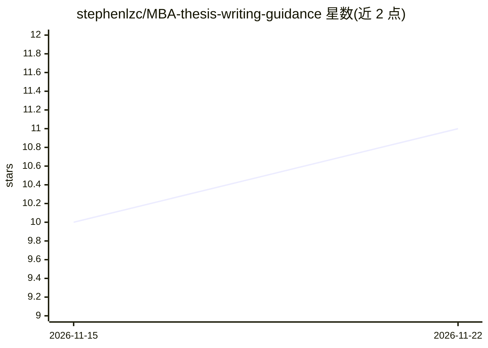

# stephenlzc/MBA-thesis-writing-guidance

⭐ 11 · Python · MIT · 推送 2026-08-21 · [GitHub](https://github.com/stephenlzc/MBA-thesis-writing-guidance) · [官网](https://stephenlzc.github.io/MBA-thesis-writing-guidance/) · 个人维护 · 中文 README

**中国 MBA/EMBA 毕业论文的 AI 辅助写作规范与技能包**

面向中国高校应用型 MBA/EMBA 毕业论文的写作指导，以标准 Agent Skill（SKILL.md + references/workflows/templates/checklists）形式分发，可加载到支持 Agent Skills 规范的 CLI/编辑器中。内容覆盖选题收窄、八方向理论菜单、五章制结构与篇幅配比、方法选用与复杂度刹车、00-06 闸门式工作流，以及 AI 使用安全/灰色/高危分区。明确声明不代写、不编造数据，学校规定优先，不保证通过开题/盲审/答辩。

## 筛选速览

| 维度 | 判定 | 备注 |
|---|---|---|
| AI 角色 | `ai-knowledge` | 知识聚合/清单类 |
| 许可风险 | `permissive` | MIT |
| 部署形态 | `library` | 以包/库形式分发 |
| 模型依赖 | — | README 未给出锁定关系 |
| 硬件要求 | — | 无带数字的原话,不猜 |
| 安装摩擦 | `low` | 无编译、无系统依赖或容器化 |
| 成熟度 | — | 结构信号不足 |

## 能力要点

- 标准 Agent Skills 规范技能包，不绑定单一模型或产品
- 00-06 闸门式工作流：从接入、选题到答辩的阶段路由
- 八个主方向各配理论菜单与题名粒度示例，不默认营销 4P
- AI 用途安全/灰色/高危三区划分与学术诚信边界

## 适用场景

- 在职 MBA 写毕业论文时让 Agent 按阶段拆任务、对照清单指出缺口
- 开题被打回后把大题目收窄到可做的对象与证据路径
- 不确定 AI 用到哪一步时对照三区清单判断合规边界

## 场景标签

`AI 写作` · 领域:内容生成

## 证据(README 行号)

> L17: 一套给 **应用型管理学位论文** 用的写作闸门：先把题目收到能做的粒度，再按五章把证据、理论和对策对齐，最后能拿去开题、盲审和答辩。
> L69: 本仓库遵循开放的 Agent Skills 规范：根目录一个 `SKILL.md`，细则放在 `references/` 等目录。只要产品能加载这种技能文件夹，就可以用，不绑某一家模型。
> L29: 人和 Agent 都可以用：你自己对着清单写，或把本目录加载成 Skill，让 Agent 按阶段拆任务、对照规范。

## 星数曲线

2026-11-15 10 → 2026-11-22 11（+1）

---
*卡片 v1 · prompt 1.4 · 生成 2026-11-19 · 置信度 high · 依据 README sha `d1f87c08f90a` · [字段定义](../../DATASET.md)*
