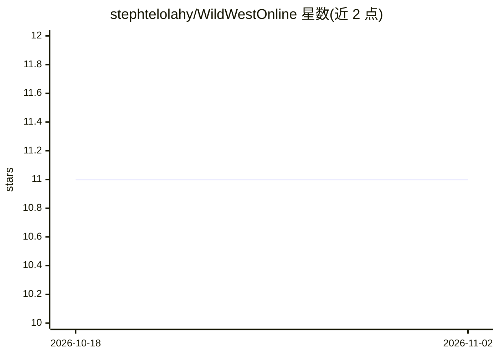

# stephtelolahy/WildWestOnline

⭐ 11 · Swift · 推送 2026-10-01 · [GitHub](https://github.com/stephtelolahy/WildWestOnline) · 个人维护

**Bang! 卡牌游戏引擎原型：DSL 定义卡牌与规则**

用 Swift 编写的回合制交换卡牌游戏引擎原型，目标是支持卡牌游戏的原型设计与规则测试。核心机制包括：领域专用语言（DSL）定义卡牌属性、事件触发动作与效果；基于图的深度优先效果求解，支持等待用户输入；Game/Player/Card/Action/Effect/Selector 元模型；可序列化游戏状态与 Redux 式单向数据流状态管理；模块化架构分为 Core/Data/UI/Utilities。当前已支持经典 Bang!，扩展包、回放与多人在线为未完成项。

## 筛选速览

| 维度 | 判定 | 备注 |
|---|---|---|
| AI 角色 | `ai-enhanced` | 去掉 AI 部分产品仍成立 |
| 许可风险 | `none` | — |
| 部署形态 | `None` |  |
| 模型依赖 | — | README 未给出锁定关系 |
| 硬件要求 | — | 无带数字的原话,不猜 |
| 安装摩擦 | `low` | 无编译、无系统依赖或容器化 |
| 成熟度 | `idea` | |

## 能力要点

- 卡牌 DSL 定义属性、事件动作、效果与选择器
- 基于图的效果求解，支持阻塞等待用户输入
- Redux 式单向数据流与可序列化游戏状态
- 模块化架构（Core/Data/UI/Utilities）

## 适用场景

- 原型设计回合制交换卡牌游戏并验证规则
- 定义与测试 Bang! 及类似卡牌游戏的卡牌效果
- 参考卡牌游戏引擎的元模型与状态管理实现

## 场景标签

 · 领域:游戏/游戏引擎开发

## 证据(README 行号)

> L5: **Prototyping a game engine for the Bang!>) card game**
> L14: - [x] Game DSL

## 星数曲线

2026-10-18 11 → 2026-11-02 11（+0）

---
*卡片 v1 · prompt 1.4 · 生成 2026-11-01 · 置信度 low · 依据 README sha `7b604f9cf9ee` · [字段定义](../../DATASET.md)*
