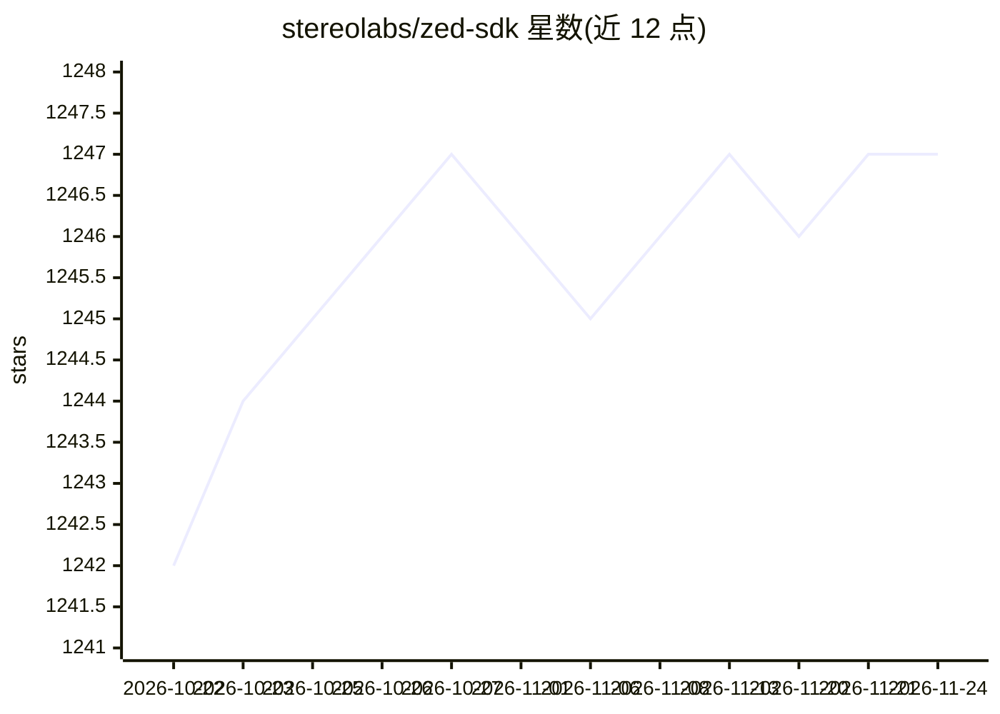

# stereolabs/zed-sdk

⭐ 1,247 · C++ · MIT · 推送 2026-11-23 · [GitHub](https://github.com/stereolabs/zed-sdk) · [官网](https://stereolabs.com) · 组织维护

**为 ZED 相机开发空间感知应用的跨平台 SDK**

Stereolabs 官方 SDK，配合 ZED 立体相机使用，提供深度感知、目标检测、人体跟踪、位置跟踪、全局定位、空间建模、多相机融合等模块，并附教程与按模块组织的代码示例（点云、网格、SVO 录制回放等）。支持 Windows/Linux/Jetson，可经 C++/Python/C#/C 集成到 Unity、ROS 2、OpenCV 等环境。需 NVIDIA GPU（算力>5），官方提供 Docker 镜像。

## 筛选速览

| 维度 | 判定 | 备注 |
|---|---|---|
| AI 角色 | `ai-native` | 本体是模型或模型工具 |
| 许可风险 | `permissive` | MIT |
| 部署形态 | `self-host` | docker 或自建部署 |
| 模型依赖 | — | README 未给出锁定关系 |
| 硬件要求 | — | 无带数字的原话,不猜 |
| 安装摩擦 | `low` | 无编译、无系统依赖或容器化 |
| 成熟度 | — | 结构信号不足 |

## 能力要点

- 深度感知、目标检测、人体跟踪、位置跟踪、空间建模等模块
- C++/Python/C#/C API 及 Unity/Unreal/ROS 2/OpenCV/YOLO 集成
- 支持 Windows、Linux 与 NVIDIA Jetson，提供 Docker 镜像
- 5.5 版引入 GEN_2 人体跟踪、TensorRT 11 支持与 Jetson 零拷贝采集

## 适用场景

- 为机器人开发深度感知与避障程序
- 构建人体姿态跟踪与行为分析应用
- 做空间三维建模与建图
- 融合 GNSS 数据做全局定位

## 场景标签

`目标检测` · 领域:感知与多模态

## 证据(README 行号)

> L3:  The ZED SDK is a cross-platform library designed to get the best out of the ZED cameras.
> L84: * **Object Detection** - This sample shows how to use the **Object Detection API** module with the ZED.
> L86: * **Body Tracking** - This sample shows how to use the **Body Tracking API** with the ZED.

## 星数曲线

2026-10-22 1,242 → 2026-11-24 1,247（+5）

---
*卡片 v1 · prompt 1.4 · 生成 2026-11-23 · 置信度 mid · 依据 README sha `c2cb96cbe0f6` · [字段定义](../../DATASET.md)*
