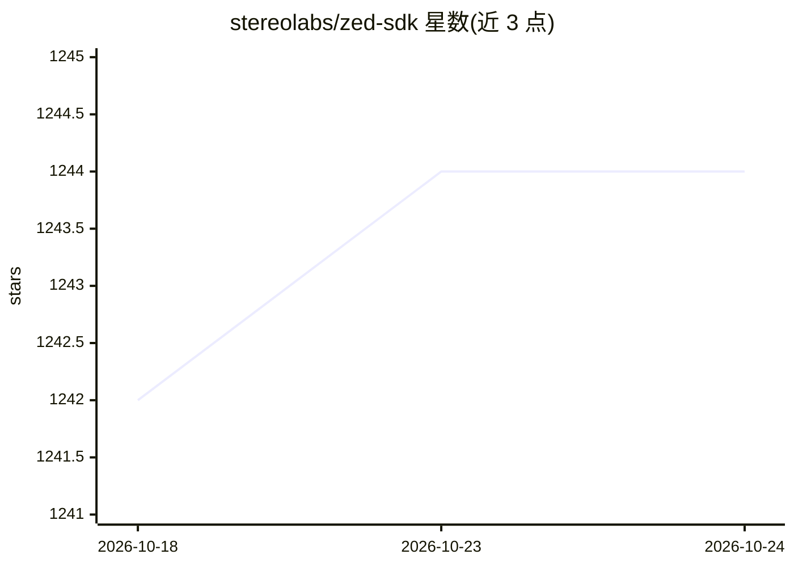

# stereolabs/zed-sdk

⭐ 1,244 · C++ · MIT · 推送 2026-10-21 · [GitHub](https://github.com/stereolabs/zed-sdk) · [官网](https://stereolabs.com) · 组织维护

**ZED 立体相机的空间感知 SDK：深度/检测/追踪/建图**

Stereolabs 为 ZED 立体相机提供的跨平台空间感知库及配套教程与示例：涵盖深度感知、物体检测、人体追踪、位置追踪、全局定位（GNSS 融合）、空间建图、相机控制与多相机融合等模块。支持 C++/Python/C#/C 集成，可与 Unity、ROS/ROS 2、OpenCV、PyTorch、Isaac SIM 等第三方库配合。要求配备计算能力 >5 的 NVIDIA GPU，支持 Windows、Linux 与 Jetson 平台；需先购买 ZED 相机硬件。仓库本身为教程与示例集合，SDK 需另行下载安装。

## 筛选速览

| 维度 | 判定 | 备注 |
|---|---|---|
| AI 角色 | `ai-native` | 本体是模型或模型工具 |
| 许可风险 | `permissive` | MIT |
| 部署形态 | `self-host` | docker 或自建部署 |
| 模型依赖 | — | README 未给出锁定关系 |
| 硬件要求 | — | 无带数字的原话,不猜 |
| 安装摩擦 | `low` | 无编译、无系统依赖或容器化 |
| 成熟度 | `idea` | |

## 能力要点

- 深度感知、物体检测、人体追踪、空间建图等模块化 API
- 位置追踪与 GNSS 数据融合实现全局定位
- 支持 C++/Python/C#/C 及 Unity、ROS 2、PyTorch 等集成
- 5.4 版开放 DEPTH_MODE::CUSTOM 接入外部深度算法

## 适用场景

- 用 ZED 相机做机器人实时深度感知与 SLAM
- 开发人体追踪或物体检测应用
- 将立体视觉数据导入 Unity 或 ROS 2 项目

## 场景标签

`教程课程` `目标检测` · 领域:学习与行业

## 证据(README 行号)

> L34: Depth Sensing | Object Detection | Body Tracking |
> L84: * **Object Detection** - This sample shows how to use the **Object Detection API** module with the ZED.

## 星数曲线

2026-10-18 1,242 → 2026-10-24 1,244（+2）

---
*卡片 v1 · prompt 1.4 · 生成 2026-10-21 · 置信度 mid · 依据 README sha `9f289b7bc80d` · [字段定义](../../DATASET.md)*
