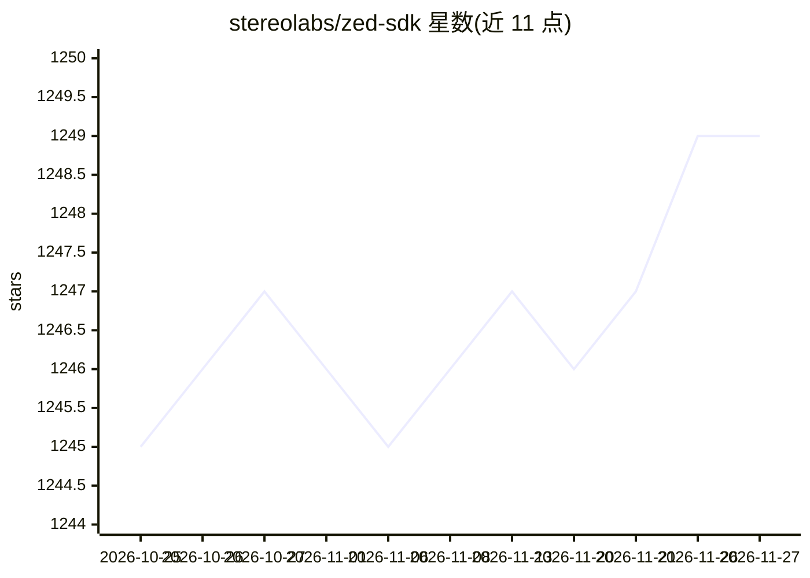

# stereolabs/zed-sdk

⭐ 1,249 · C++ · MIT · 推送 2026-11-23 · [GitHub](https://github.com/stereolabs/zed-sdk) · [官网](https://stereolabs.com) · 组织维护

**为 ZED 相户开发空间感知应用的跨平台 SDK**

Stereolabs 官方的跨平台空间感知库，配合 ZED 系列相机使用，提供深度感知、目标检测、人体跟踪、位置跟踪、全局定位、空间映射、平面检测与多相机融合等模块。本仓库为 SDK 的教程与代码示例集合，按模块组织，覆盖 C++、Python、C#、C 语言接口，并可集成 Unity、ROS、OpenCV 等第三方环境。SDK 需 NVIDIA GPU（Compute Capability > 5），支持 Windows、Linux 与 Jetson 平台，提供 Docker 镜像。

## 筛选速览

| 维度 | 判定 | 备注 |
|---|---|---|
| AI 角色 | `ai-native` | 本体是模型或模型工具 |
| 许可风险 | `permissive` | MIT |
| 部署形态 | `self-host` | docker 或自建部署 |
| 模型依赖 | — | README 未给出锁定关系 |
| 硬件要求 | — | 无带数字的原话,不猜 |
| 安装摩擦 | `low` | 无编译、无系统依赖或容器化 |
| 成熟度 | — | 结构信号不足 |

## 能力要点

- 深度感知、目标检测、人体跟踪、空间映射等模块示例
- 支持 C++/Python/C#/C 四种语言接口
- 多相机 SLAM 与外部运动先验（轮式里程计/VIO）融合
- 支持 Ubuntu/Windows/Jetson 平台，需 NVIDIA GPU

## 适用场景

- 为机器人开发实时深度感知与空间建图
- 做人形/人体姿态跟踪与目标检测
- 多相机融合的全局定位与 SLAM
- 无相机时用 SVO 录制文件回放开发调试

## 场景标签

`教程课程` `目标检测` · 领域:学习与行业

## 证据(README 行号)

> L3:  The ZED SDK is a cross-platform library designed to get the best out of the ZED cameras.
> L34: Depth Sensing | Object Detection | Body Tracking |
> L106: The ZED SDK requires the use of an **NVIDIA GPU** with a **Compute Capability > 5**.

## 星数曲线

2026-10-25 1,245 → 2026-11-27 1,249（+4）

---
*卡片 v1 · prompt 1.4 · 生成 2026-11-25 · 置信度 high · 依据 README sha `bfe08b118388` · [字段定义](../../DATASET.md)*
