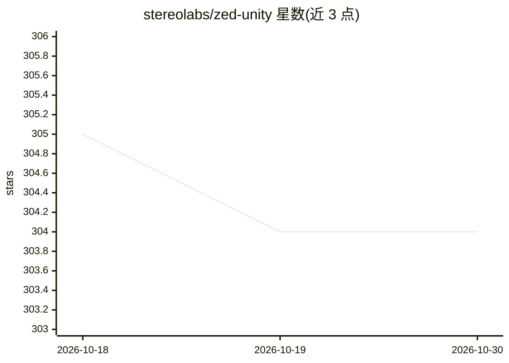

# stereolabs/zed-unity

⭐ 304 · C# · MIT · 推送 2026-09-22 · [GitHub](https://github.com/stereolabs/zed-unity) · [官网](https://www.stereolabs.com/documentation/guides/using-zed-with-unity/introduction.html) · 组织维护

**将 ZED 相机功能带入 Unity 的官方插件**

Stereolabs 官方维护的 Unity 插件，把 ZED 立体相机的深度感知、AR/MR、空间建图、点云等能力以 prefab、辅助脚本和示例场景的形式提供给 Unity 开发者。功能包含身体追踪、物体检测、平面检测、ArUco 标记检测、绿幕抠像等（依赖 ZED SDK 4.1 相应模块）。要求 Windows 10/11 或 Ubuntu 20/22、Unity 2021.3+，GPU 需 CUDA 10.2 能力及以上（推荐 GTX 1060+），支持 OpenVR/Oculus HMD。

## 筛选速览

| 维度 | 判定 | 备注 |
|---|---|---|
| AI 角色 | `ai-enhanced` | 去掉 AI 部分产品仍成立 |
| 许可风险 | `permissive` | MIT |
| 部署形态 | `None` |  |
| 模型依赖 | — | README 未给出锁定关系 |
| 硬件要求 | — | 无带数字的原话,不猜 |
| 安装摩擦 | `medium` | 含编译或系统依赖之一 |
| 成熟度 | — | 结构信号不足 |

## 能力要点

- 身体追踪、物体检测、平面检测、空间建图等 prefab 与示例场景
- 通过 Unity Package Manager 以 git URL 安装，含可复用示例脚本
- 支持 OpenVR/Oculus HMD 的 AR/VR 场景
- 支持 URP 与 HDRP 渲染管线（见文档）

## 适用场景

- 在 Unity 中开发 ZED 相机驱动的 AR/MR 应用
- 做基于身体追踪的 3D 化身动画或动捕
- 用 ZED 深度数据在 Unity 中做点云可视化与空间建图

## 场景标签

`图像视频处理` `目标检测` · 领域:感知与多模态

## 证据(README 行号)

> L3: This package brings the features of the ZED cameras into Unity. It comes with prefabs to make adding advanced featur
> L52: - Body Tracking: Animate a 3D avatar based on real-people movements using the ZED SDK Body Tracking module.
> L58: - Object Detection: Detect objects and people bounding boxes using the ZED SDK Object Detection module.

## 星数曲线

2026-10-18 305 → 2026-10-30 304（-1）

---
*卡片 v1 · prompt 1.4 · 生成 2026-10-22 · 置信度 high · 依据 README sha `afab688ebe8e` · [字段定义](../../DATASET.md)*
