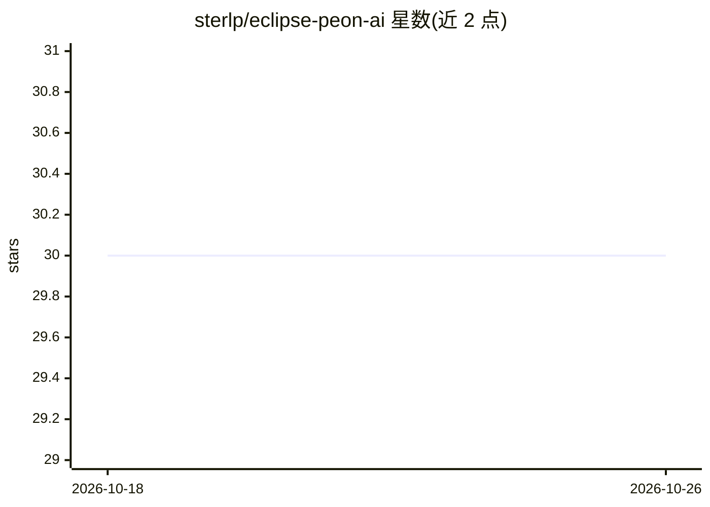

# sterlp/eclipse-peon-ai

⭐ 30 · Java · NOASSERTION · 推送 2026-10-25 · [GitHub](https://github.com/sterlp/eclipse-peon-ai) · [官网](https://peon-ai-4e.sterl.org/) · 个人维护

**Eclipse IDE 内的 LLM 编程助手插件，支持本地与云端模型**

面向使用 Eclipse 的 Java 开发者的 LLM 助手插件：提供聊天界面、语音对话、文件读写与搜索、代码导航、构建与测试触发等工具，具备 Agent 模式、MCP 服务器接入、自定义 Agent 与技能（~/.peon 目录）。基于 LangChain4j 构建，支持 Ollama、LM Studio、OpenAI 及兼容 API、Gemini、Mistral、Anthropic、GitHub Copilot 等多提供方，强调离线本地推理。要求 Java 21 与 Eclipse 2025-12 或更新版本，经 Eclipse Marketplace 或更新站点安装。

## 筛选速览

| 维度 | 判定 | 备注 |
|---|---|---|
| AI 角色 | `ai-ecosystem` | LLM/agent 周边工具 |
| 许可风险 | `none` | NOASSERTION |
| 部署形态 | `None` |  |
| 模型依赖 | local-ok | 支持本地模型 |
| 硬件要求 | — | 无带数字的原话,不猜 |
| 安装摩擦 | `medium` | 含编译或系统依赖之一 |
| 成熟度 | — | 结构信号不足 |

## 能力要点

- 聊天/语音交互与工作区上下文感知
- 文件操作、Grep、构建、JUnit 测试、代码导航（JDT）等工具集
- 多提供方支持：Ollama/LM Studio/OpenAI 兼容/Gemini/Mistral/Claude/Copilot
- MCP 接入、自定义 Agent 与 agentskills.io 规范技能

## 适用场景

- 在 Eclipse 中通过对话让 AI 读写代码、生成单元测试
- 配置 Ollama 等本地模型进行隐私优先的离线辅助编程
- 用自定义 Agent 与技能固定团队编码规范

## 场景标签

 · 领域:开发者工具/AI 编程助手

## 证据(README 行号)

> L8: A lightweight, context-aware LLM assistant that integrates directly into your Eclipse workbench to support developer
> L158: - LangChain4j - Java LLM framework

## 星数曲线

2026-10-18 30 → 2026-10-26 30（+0）

---
*卡片 v1 · prompt 1.4 · 生成 2026-10-26 · 置信度 high · 依据 README sha `f2112459327d` · [字段定义](../../DATASET.md)*
