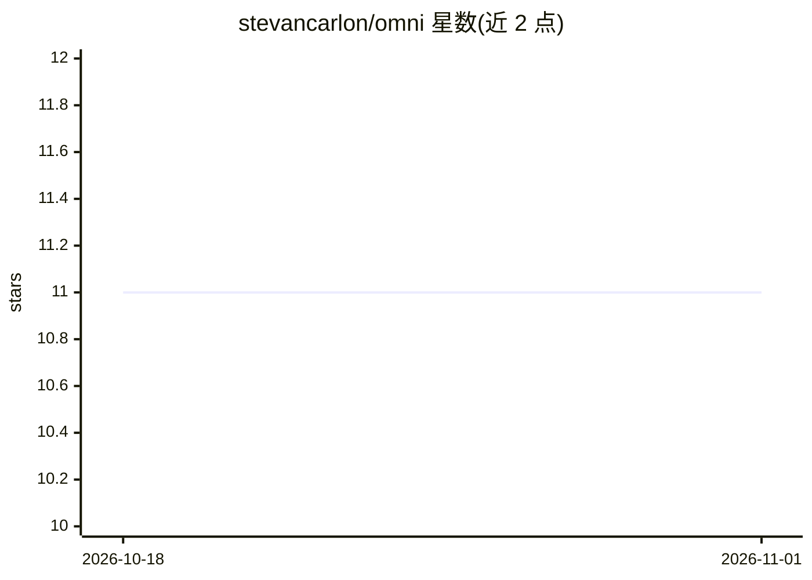

# stevancarlon/omni

⭐ 11 · Kotlin · Apache-2.0 · 推送 2026-08-18 · [GitHub](https://github.com/stevancarlon/omni) · [官网](https://github.com/stevancarlon/omni) · 个人维护

**自托管的 Android computer-use 智能体：看屏幕并代替用户操作手机**

开源 Android agent，读取当前屏幕内容，通过 Android Accessibility API 执行点击、输入、滑动、打开应用等操作，根据目标自适应执行。仓库含 Kotlin 原生应用与可自托管的 Elixir/Phoenix 后端，社区版使用自己的后端与 API key，无需 Google 登录或商店订阅。需选择一家 LLM 提供商（Gemini/Groq/OpenAI/Anthropic），可选 Deepgram 语音唤醒。标注为实验性 alpha 软件，尚未上架 Google Play。

## 筛选速览

| 维度 | 判定 | 备注 |
|---|---|---|
| AI 角色 | `ai-native` | 本体是模型或模型工具 |
| 许可风险 | `permissive` | Apache-2.0 |
| 部署形态 | `self-host` | docker 或自建部署 |
| 模型依赖 | locked-api |  |
| 硬件要求 | — | 无带数字的原话,不猜 |
| 安装摩擦 | `low` | 无编译、无系统依赖或容器化 |
| 成熟度 | `idea` | |

## 能力要点

- 读取屏幕并通过 Accessibility API 代用户执行点击/输入/滑动等操作
- 自托管 Elixir/Phoenix 后端，社区版无需 Google 登录或商店订阅
- 支持 Gemini/Groq/OpenAI/Anthropic 四种 LLM 提供商，可切换
- 可选 Deepgram 唤醒词与流式语音识别、Whisper 转录精炼

## 适用场景

- 用自然语言目标让 agent 操作自己的安卓手机
- 自托管后端控制 agent 的数据与 API key
- 在模拟器上试验手机自动化 agent

## 场景标签

`GUI 自动化` · 领域:效率与自动化

## 证据(README 行号)

> L3: Omni is an experimental open-source Android agent that can see the current
> L5: goal and it can tap, type, swipe, navigate, open apps, and adapt as the screen
> L22: - An Android 10+ phone or emulator

## 星数曲线

2026-10-18 11 → 2026-11-01 11（+0）

---
*卡片 v1 · prompt 1.4 · 生成 2026-11-01 · 置信度 high · 依据 README sha `8c2dc07e93d8` · [字段定义](../../DATASET.md)*
