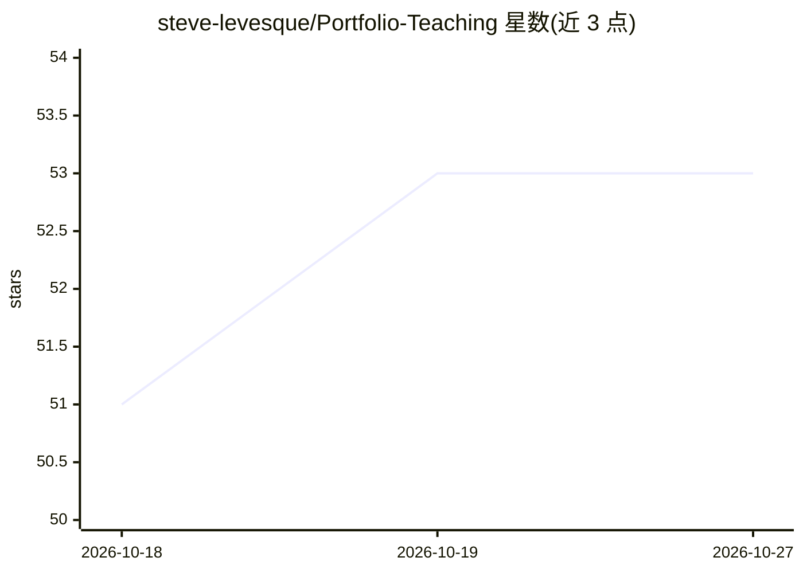

# steve-levesque/Portfolio-Teaching

⭐ 53 · 推送 2026-01-15 · [GitHub](https://github.com/steve-levesque/Portfolio-Teaching) · [官网](https://stevelevesque.com/teaching) · 个人维护

**教师个人课程教学资料合集**

仓库收录作者本人正在教授或曾教授过的各门课程的教学材料。README 仅有一行标题，未提供具体课程清单、内容结构、安装或使用说明；从主题标签可知涉及人工智能、机器学习、管理、软件工程与 Web 等方向。属于个人教学资源存档，面向选课学生或教学参考者，无软件安装运行流程。

## 筛选速览

| 维度 | 判定 | 备注 |
|---|---|---|
| AI 角色 | `ai-knowledge` | 知识聚合/清单类 |
| 许可风险 | `none` | — |
| 部署形态 | `None` |  |
| 模型依赖 | — | README 未给出锁定关系 |
| 硬件要求 | — | 无带数字的原话,不猜 |
| 安装摩擦 | `low` | 无编译、无系统依赖或容器化 |
| 成熟度 | — | 结构信号不足 |

## 能力要点

- 覆盖作者教授的多门课程的教学材料
- 主题标签涉及人工智能、机器学习、软件工程等领域

## 适用场景

- 查看作者所授课程的教学资料
- 作为相关课程的学习或备课参考

## 场景标签

`教程课程` · 领域:学习与行业

## 证据(README 行号)

> L1: # Portfolio-Teaching

## 星数曲线

2026-10-18 51 → 2026-10-27 53（+2）

---
*卡片 v1 · prompt 1.4 · 生成 2026-10-24 · 置信度 low · 依据 README sha `205674db60ba` · [字段定义](../../DATASET.md)*
