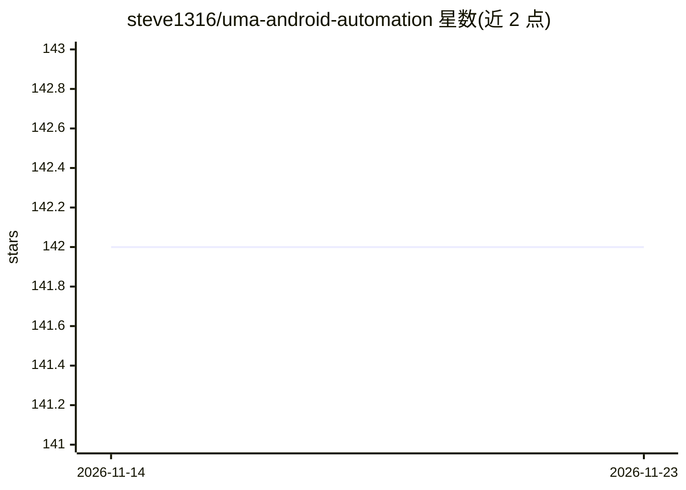

# steve1316/uma-android-automation

⭐ 142 · Kotlin · GPL-3.0 · 推送 2026-11-22 · [GitHub](https://github.com/steve1316/uma-android-automation) · 个人维护

**全自动跑《闪耀！优俊少女》育成的 Android 自动化应用**

Kotlin 编写、React Native (Expo) 作前端的 Android 应用，通过 MediaProjection 截屏、AccessibilityService 派发手势，以 OpenCV 模板匹配、YOLOv8 数值检测与 Tesseract OCR 实现实时游戏状态感知，端到端自动完成一整轮育成：事件奖励选择、属性优先级、赛程调度、技能点购买等均可配置。支持真机（需 1080p/240 DPI）与 BlueStacks/MuMu 模拟器，提供 APK 安装。另含可选的离线 RAG 文档问答（MiniLM 嵌入 + GGUF 模型，经 llama.rn 运行）。README 声明仅用于教育目的。

## 筛选速览

| 维度 | 判定 | 备注 |
|---|---|---|
| AI 角色 | `ai-enhanced` | 去掉 AI 部分产品仍成立 |
| 许可风险 | `viral` | GPL-3.0 |
| 部署形态 | `library` | 以包/库形式分发 |
| 模型依赖 | local-ok | 支持本地模型 |
| 硬件要求 | — | 无带数字的原话,不猜 |
| 安装摩擦 | `low` | 无编译、无系统依赖或容器化 |
| 成熟度 | — | 结构信号不足 |

## 能力要点

- OpenCV 模板匹配 + YOLOv8 检测 + Tesseract OCR 的实时状态识别
- 覆盖 URA Finale、Unity Cup 等多剧本的全流程自动化
- React Native/Expo 前端提供全套可配置项与配置导入导出
- 可选离线 RAG 文档问答（MiniLM + GGUF via llama.rn）

## 适用场景

- 让 bot 代刷《闪耀！优俊少女》育成流程，节省手动时间
- 在模拟器上挂机自动跑剧本并按策略买技能点
- 通过浏览器远程查看自动化日志进度

## 场景标签

`GUI 自动化` · 领域:效率与自动化

## 证据(README 行号)

> L7: This Android application written in Kotlin is designed to fully automate a run of Uma Musume Pretty Derby by offerin
> L44: - [x] Advanced OpenCV template matching for real-time gamestate awareness.
> L45: - [x] YOLOv8-powered real-time stat gain detection for improved accuracy.

## 星数曲线

2026-11-14 142 → 2026-11-23 142（+0）

---
*卡片 v1 · prompt 1.4 · 生成 2026-11-17 · 置信度 high · 依据 README sha `5c216c99eb7e` · [字段定义](../../DATASET.md)*
