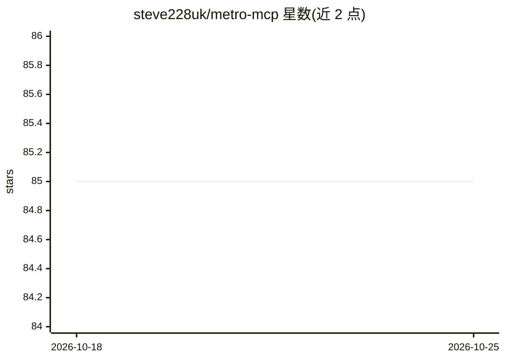

# steve228uk/metro-mcp

⭐ 85 · TypeScript · MIT · 推送 2026-09-04 · [GitHub](https://github.com/steve228uk/metro-mcp) · [官网](https://metromcp.dev/) · 个人维护

**面向 AI agent 的 React Native 运行时调试 MCP 服务器**

插件式 MCP 服务器，供 MCP 客户端（Claude Code、Codex、Cursor、VS Code、OpenCode）对 React Native 应用做运行时调试、检查与自动化。通过 Chrome DevTools Protocol 连接 Metro dev server，核心功能无需修改应用代码；内置 CDP 代理复用 Hermes 的单一调试连接，使 Chrome DevTools 与 MCP 可同时使用。提供约 27 个插件、逾 90 个工具，覆盖控制台日志、网络追踪、UI 自动化、性能剖析、测试录制（Appium/Maestro/Detox）、iOS 模拟器与 Android 设备控制等。兼容 React Native 0.70+（需 Hermes）、Expo SDK 49+，通过 npx/bunx 运行。

## 筛选速览

| 维度 | 判定 | 备注 |
|---|---|---|
| AI 角色 | `ai-ecosystem` | LLM/agent 周边工具 |
| 许可风险 | `permissive` | MIT |
| 部署形态 | `library` | 以包/库形式分发 |
| 模型依赖 | — | README 未给出锁定关系 |
| 硬件要求 | — | 无带数字的原话,不猜 |
| 安装摩擦 | `low` | 无编译、无系统依赖或容器化 |
| 成熟度 | — | 结构信号不足 |

## 能力要点

- 经 CDP 连接 Metro，核心调试功能无需修改应用代码
- 约 27 个插件覆盖控制台、网络、UI 自动化、性能剖析、测试录制等
- 内置 CDP 代理复用 Hermes 单一调试连接，DevTools 与 MCP 可并存
- 录制真实交互并生成 Appium/Maestro/Detox 测试

## 适用场景

- 让 AI agent 在 MCP 客户端中直接调试和检查 React Native 应用
- 通过自然语言驱动 UI 自动化与应用内操作
- 录制用户操作并生成自动化测试
- 排查运行时错误、网络请求与 Redux/组件树状态

## 场景标签

`GUI 自动化` · 领域:效率与自动化

## 证据(README 行号)

> L6: A plugin-based MCP server for React Native runtime debugging, inspection, and automation. Connects to Metro bundler 
> L134: 4. Exposes everything as MCP tools, resources, and prompts

## 星数曲线

2026-10-18 85 → 2026-10-25 85（+0）

---
*卡片 v1 · prompt 1.4 · 生成 2026-10-24 · 置信度 high · 依据 README sha `7474c8cc01c5` · [字段定义](../../DATASET.md)*
