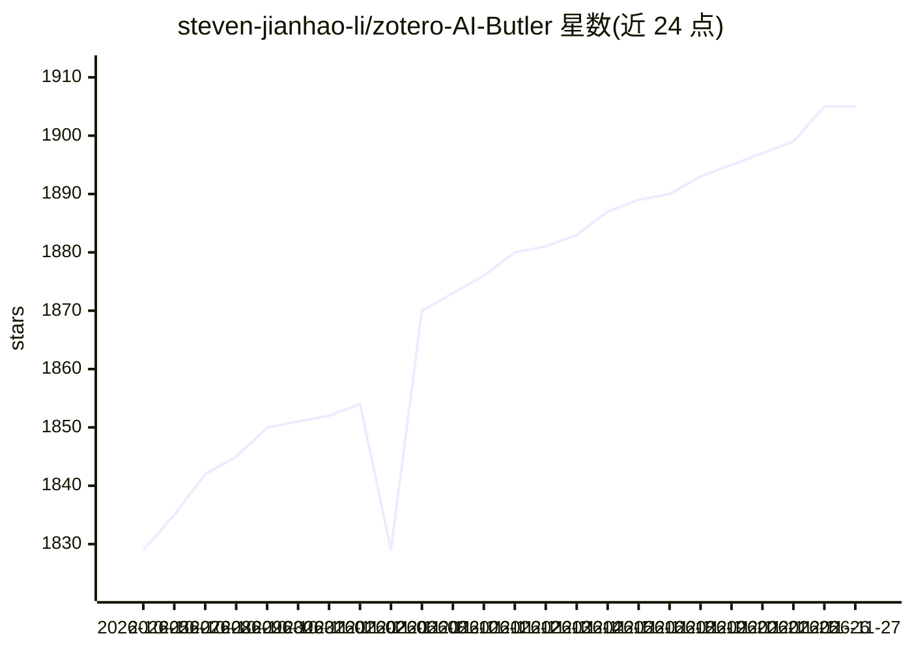

# steven-jianhao-li/zotero-AI-Butler

⭐ 1,905 · TypeScript · AGPL-3.0 · 推送 2026-11-26 · [GitHub](https://github.com/steven-jianhao-li/zotero-AI-Butler) · [官网](https://github.com/steven-jianhao-li/zotero-AI-Butler/releases) · 个人维护 · 中文 README

**Zotero 插件：自动精读论文并生成 Markdown 笔记**

以 Zotero 插件形式（.xpi 安装）运行的文献阅读助手：自动扫描新添加的 PDF，调用用户自配的大模型 API 生成 Markdown 精读笔记并保存到条目下。支持右键即时分析、自动巡航、批量回溯三种触发方式，多轮对话精读、多文献综述、思维导图（PNG/OPML 导出）、一图总结、侧边栏追问与 LaTeX 公式渲染。插件本身不提供模型服务，需用户自行申请并配置 API Key，不收集上传用户数据。

## 筛选速览

| 维度 | 判定 | 备注 |
|---|---|---|
| AI 角色 | `ai-native` | 本体是模型或模型工具 |
| 许可风险 | `viral` | AGPL-3.0 |
| 部署形态 | `None` |  |
| 模型依赖 | local-ok | 支持本地模型 |
| 硬件要求 | — | 无带数字的原话,不猜 |
| 安装摩擦 | `low` | 无编译、无系统依赖或容器化 |
| 成熟度 | — | 结构信号不足 |

## 能力要点

- 自动扫描新 PDF 并生成 Markdown 精读笔记，支持右键、自动巡航、批量三种触发方式
- 支持 Base64 多模态上传与文字提取两种 PDF 处理模式
- 多文献综述生成与思维导图（PNG/OPML 导出）
- 内置多种提示词模板，支持自定义与多轮对话精读

## 适用场景

- 文献拖入 Zotero 后自动生成精读笔记
- 批量补充总结文献库中积压的旧论文
- 对整个分类的多篇论文生成文献综述报告
- 阅读论文时在侧边栏向大模型追问公式与细节

## 场景标签

`科研工具` `文档问答` · 领域:知识与检索

## 证据(README 行号)

> L43: 2. **自动化处理**：管家自动扫描新添加的PDF文献，利用大模型生成条理清晰的Markdown笔记，和论文条目一同保存，随时都能回顾。
> L50: 9. **开源平台**：AI管家旨在提供一个自由、定制化的智能论文管理平台。所有模型提示词均可自定义——如何读文献，由您说了算；支持多个大模型的API——选择哪个大模型，也由您说了算。AI管家本身无任何收费渠道。
> L147: AI管家支持多种主流大模型平台，满足不同用户的需求：

## 星数曲线

2026-10-25 1,829 → 2026-11-27 1,905（+76）

---
*卡片 v1 · prompt 1.4 · 生成 2026-11-23 · 置信度 high · 依据 README sha `3845faaa29d3` · [字段定义](../../DATASET.md)*
