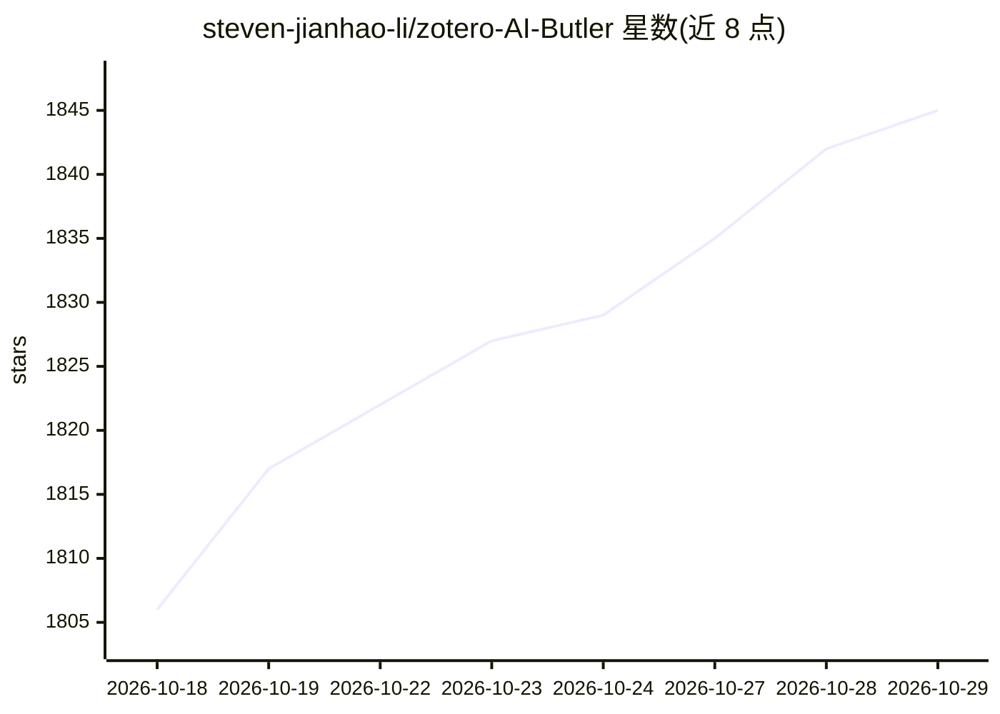

# steven-jianhao-li/zotero-AI-Butler

⭐ 1,845 · TypeScript · AGPL-3.0 · 推送 2026-10-28 · [GitHub](https://github.com/steven-jianhao-li/zotero-AI-Butler) · [官网](https://github.com/steven-jianhao-li/zotero-AI-Butler/releases) · 个人维护 · 中文 README

**Zotero 插件：自动精读论文并生成总结笔记**

第三方开源 Zotero 插件，面向使用 Zotero 管理文献的研究者。用户新增 PDF 后，插件调用自行配置的大模型 API（OpenAI、Gemini、Anthropic、OpenAI 兼容、火山方舟、Ollama），自动生成 Markdown 总结笔记并保存到对应条目；支持论文精读、多轮对话总结、一图总结（学术海报）、思维导图（可导出 PNG/OPML）、多文献综述、侧边栏笔记预览与追问、Agent 研究助手。PDF 可经 Base64 多模态上传或文本提取处理。不提供模型代理服务，API Key 由用户自行申请配置，以 .xpi 文件安装进 Zotero 桌面端。

## 筛选速览

| 维度 | 判定 | 备注 |
|---|---|---|
| AI 角色 | `ai-native` | 本体是模型或模型工具 |
| 许可风险 | `viral` | AGPL-3.0 |
| 部署形态 | `None` |  |
| 模型依赖 | local-ok | 支持本地模型 |
| 硬件要求 | — | 无带数字的原话,不猜 |
| 安装摩擦 | `low` | 无编译、无系统依赖或容器化 |
| 成熟度 | `idea` | |

## 能力要点

- 自动扫描新添加 PDF 并生成 Markdown 总结笔记
- 支持 OpenAI、Gemini、Anthropic、OpenAI 兼容、火山方舟、Ollama 等平台 API
- 多轮对话（拼接/总结）、一图总结、思维导图与多文献综述生成
- 提示词模板可自定义，PDF 支持 Base64 多模态或文本提取两种处理方式

## 适用场景

- 批量精读文献库积压的论文并自动生成回顾笔记
- 阅读原文时在侧边栏对照 AI 笔记并随时追问
- 对分类下多篇论文一键生成文献综述报告
- 为每篇论文生成思维导图并导出到 XMind 等工具

## 场景标签

`科研工具` `文档问答` · 领域:知识与检索

## 证据(README 行号)

> L39: 1. **自动化处理**：管家自动扫描新添加的PDF文献，利用大模型生成条理清晰的Markdown笔记，和论文条目一同保存，随时都能回顾。
> L61: AI管家的核心使命是利用大模型（如 Gemini 或 OpenAI）深度阅读论文，并将总结内容自动整理为条理清晰的 Markdown 笔记，保存至 Zotero 条目下。
> L116:  - API配置： 目前支持 OpenAI、Gemini、Anthropic 以及 OpenAI兼容（支持第三方如硅基流动等）四大平台。配置密钥后可点击 “测试连接” 验证可用性。

## 星数曲线

2026-10-18 1,806 → 2026-10-29 1,845（+39）

---
*卡片 v1 · prompt 1.4 · 生成 2026-10-21 · 置信度 high · 依据 README sha `a102cf38242b` · [字段定义](../../DATASET.md)*
