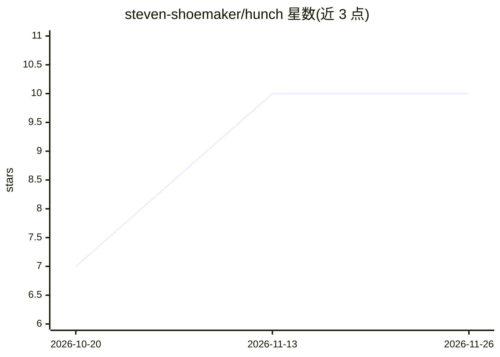

# steven-shoemaker/hunch

⭐ 10 · Python · MIT · 推送 2026-09-22 · [GitHub](https://github.com/steven-shoemaker/hunch) · 个人维护

**数据列上批量问答分类的 Python 库：列表进列表出**

以 Python 函数形式对字符串、列表或 DataFrame 列逐行做封闭集问答：classify/score/check/where/extract/pick/rank 等动词覆盖分类、打分、真值判断、语义过滤与字段抽取。判断由 Jev（TypeSafe 的分类器服务）完成，返回概率分布而非散文；重复值去重、请求并行、答案缓存。可选配置 LLM（Claude/OpenAI/OpenRouter/Ollama 等）仅用于 generate/discover/refine 等动词；不配置 LLM 也可运行。另提供 TypeScript 版本与给编码代理使用的 skill。

## 筛选速览

| 维度 | 判定 | 备注 |
|---|---|---|
| AI 角色 | `ai-native` | 本体是模型或模型工具 |
| 许可风险 | `permissive` | MIT |
| 部署形态 | `library` | 以包/库形式分发 |
| 模型依赖 | local-ok | 支持本地模型 |
| 硬件要求 | — | 无带数字的原话,不猜 |
| 安装摩擦 | `low` | 无编译、无系统依赖或容器化 |
| 成熟度 | — | 结构信号不足 |

## 能力要点

- classify/score/check/where/extract 等动词直接作用于 DataFrame 列并保持原索引形状
- 每条答案带概率分布与 sure/split/unsure 形状，供代码分支与人工复审
- 重复值只请求一次、答案缓存、请求并行
- 可选 LLM 仅用于生成、发现类别与改写，未配置则不需要

## 适用场景

- 给评论/工单数据批量打主题标签并按形状分流复审
- 用 where 做语义 WHERE 行筛选、用 extract 抽取发票金额与日期
- 对 LLM 产出的声明做 verify 来源核验
- 用 evaluate/tune_threshold 标注样本人群校准阈值

## 场景标签

`数据分析` · 领域:效率与自动化

## 证据(README 行号)

> L5: **Judgment as a Python function.** Ask a question about a string, a list, or a whole DataFrame column, and get an an
> L29: **Jev does the judging.** Jev is TypeSafe's classifier with frontier-level intelligence, and it needs no fine-tunin

## 星数曲线

2026-10-20 7 → 2026-11-26 10（+3）

---
*卡片 v1 · prompt 1.4 · 生成 2026-11-19 · 置信度 mid · 依据 README sha `cc79d9eeb95f` · [字段定义](../../DATASET.md)*
