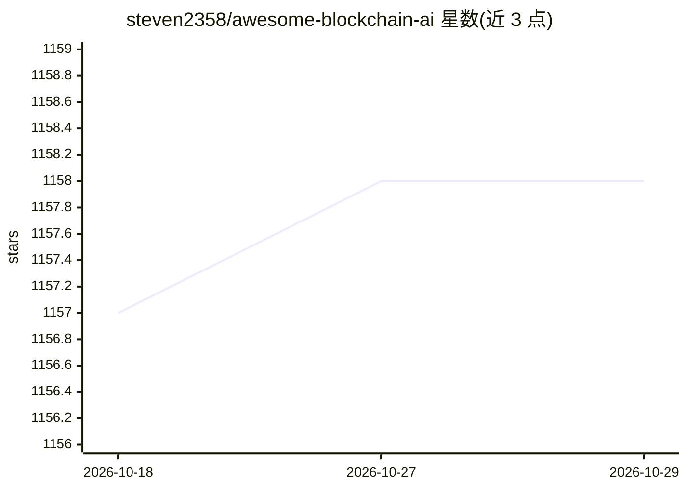

# steven2358/awesome-blockchain-ai

⭐ 1,158 · 推送 2026-02-06 · [GitHub](https://github.com/steven2358/awesome-blockchain-ai) · 个人维护

**区块链×AI 项目策展清单：收录去中心化 AI 相关项目与论文**

一份 awesome 类策展清单，收录利用区块链特性（去中心化、不可篡改、智能合约）构建 AI 系统的项目。按类别组织：AI 算法链（SingularityNET、Bittensor 等）、数据链（Ocean Protocol）、算力链（DeepBrain Chain、Phala）、金融/医疗场景、自主 agent 以及学术论文（Proof of Learning 等共识机制研究）。每个条目附一句话简介，另设推荐阅读栏目。采用 CC0 许可，无安装或运行内容。

## 筛选速览

| 维度 | 判定 | 备注 |
|---|---|---|
| AI 角色 | `ai-knowledge` | 知识聚合/清单类 |
| 许可风险 | `none` | — |
| 部署形态 | `None` |  |
| 模型依赖 | — | README 未给出锁定关系 |
| 硬件要求 | — | 无带数字的原话,不猜 |
| 安装摩擦 | `low` | 无编译、无系统依赖或容器化 |
| 成熟度 | — | 结构信号不足 |

## 能力要点

- 按用途分类收录区块链 AI 项目（算法/数据/算力/金融/医疗/agent）
- 收录 12 篇学术研究条目（含区块链共识×机器学习）
- 附推荐阅读与 Wikipedia 背景 entry

## 适用场景

- 调研去中心化 AI / 区块链机器学习领域的项目分布
- 查找特定场景（金融、医疗、算力市场）的区块链 AI 项目
- 查找区块链共识机制与机器学习结合的学术论文

## 场景标签

`精选清单` · 领域:学习与行业

## 证据(README 行号)

> L3: > A curated list of Blockchain projects for Artificial Intelligence and Machine Learning.
> L5: This list explores awesome projects that exploit the properties of blockchain technologies (decentralization, immuta

## 星数曲线

2026-10-18 1,157 → 2026-10-29 1,158（+1）

---
*卡片 v1 · prompt 1.4 · 生成 2026-10-21 · 置信度 high · 依据 README sha `9b925705dfdd` · [字段定义](../../DATASET.md)*
