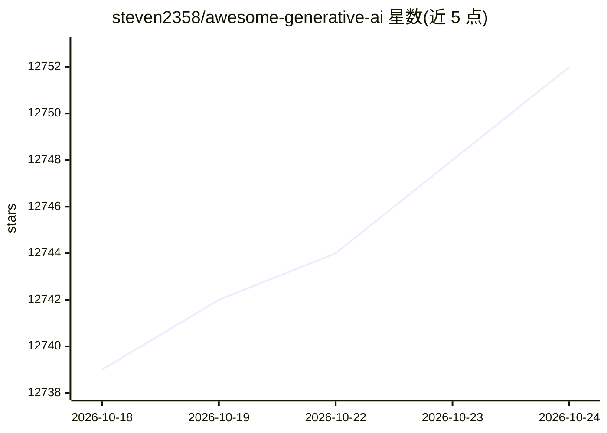

# steven2358/awesome-generative-ai

⭐ 12,760 · CC0-1.0 · 推送 2026-10-24 · [GitHub](https://github.com/steven2358/awesome-generative-ai) · 个人维护

**生成式 AI 项目与服务策展清单，覆盖文本、图像等多领域**

由 steven2358 维护的生成式 AI 策展清单：按文本、图像、音频、视频等类别组织条目，文本部分细分为模型、聊天机器人、自定义界面、搜索引擎、写作助手、ChatGPT 扩展、生产力、会议助手、学术工具等子类；另设推荐阅读与行业里程碑（OpenAI API、DALL·E 2、ChatGPT、GPT-4 等）板块。条目以开源项目与商业服务并列收录，开源项标注 #opensource 标签，通过 PR 接受社区贡献。

## 筛选速览

| 维度 | 判定 | 备注 |
|---|---|---|
| AI 角色 | `ai-knowledge` | 知识聚合/清单类 |
| 许可风险 | `viral` | CC0-1.0 |
| 部署形态 | `None` |  |
| 模型依赖 | — | README 未给出锁定关系 |
| 硬件要求 | — | 无带数字的原话,不猜 |
| 安装摩擦 | `low` | 无编译、无系统依赖或容器化 |
| 成熟度 | — | 结构信号不足 |

## 能力要点

- 按类别与子类组织的生成式 AI 项目/服务条目
- 开源条目统一标注 #opensource 标签
- 附行业里程碑时间线与推荐阅读文章
- 社区通过 PR 与 issue 贡献条目

## 适用场景

- 查找生成式 AI 各领域的可用工具与模型
- 了解生成式 AI 行业的关键事件与演进时间线
- 为项目选型时浏览同类开源替代品

## 场景标签

`精选清单` · 领域:学习与行业

## 证据(README 行号)

> L3: > A curated list of modern Generative Artificial Intelligence projects and services.
> L9: ## Contents
> L32: ## Text

## 星数曲线

2026-10-18 12,739 → 2026-10-24 12,752（+13）

---
*卡片 v1 · prompt 1.4 · 生成 2026-10-20 · 置信度 high · 依据 README sha `8d15bb05f5e2` · [字段定义](../../DATASET.md)*
