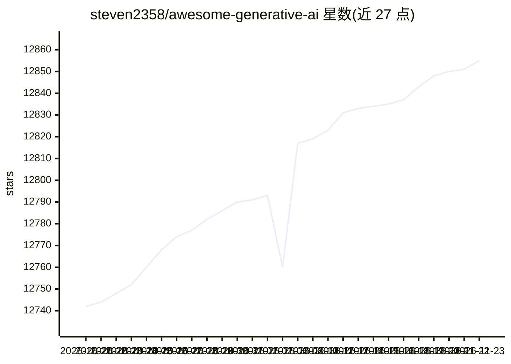

# steven2358/awesome-generative-ai

⭐ 12,855 · CC0-1.0 · 推送 2026-11-20 · [GitHub](https://github.com/steven2358/awesome-generative-ai) · 个人维护

**生成式 AI 项目与服务的策展清单**

以 awesome-list 形式维护的生成式 AI 项目目录，按模态与应用类别组织条目：文本（模型、聊天机器人、写作助手、搜索引擎、会议助手、学术工具）、图像、音频、视频等，每条附一句话描述与开源标记。另收录里程碑事件时间线与推荐阅读文章，欢迎通过 PR/issue 贡献，并维护独立的 Discoveries List 收录新兴项目。面向需要查找生成式 AI 项目与服务的读者。

## 筛选速览

| 维度 | 判定 | 备注 |
|---|---|---|
| AI 角色 | `ai-knowledge` | 知识聚合/清单类 |
| 许可风险 | `viral` | CC0-1.0 |
| 部署形态 | `None` |  |
| 模型依赖 | — | README 未给出锁定关系 |
| 硬件要求 | — | 无带数字的原话,不猜 |
| 安装摩擦 | `low` | 无编译、无系统依赖或容器化 |
| 成熟度 | — | 结构信号不足 |

## 能力要点

- 按文本/图像/音频/视频等模态与应用类别组织的条目结构
- 收录 GPT-3 到 Sora 等里程碑事件时间线与推荐阅读
- 带 #opensource 标记的开源条目可快速筛选
- 配套 Discoveries List 收录新兴项目

## 适用场景

- 寻找某类生成式 AI 的开源项目或在线服务
- 了解生成式 AI 生态的发展脉络与重要节点
- 为调研或选型收集候选项目清单

## 场景标签

`精选清单` · 领域:学习与行业

## 证据(README 行号)

> L3: > A curated list of modern Generative Artificial Intelligence projects and services.
> L9: ## Contents
> L32: ## Text

## 星数曲线

2026-10-21 12,742 → 2026-11-23 12,855（+113）

---
*卡片 v1 · prompt 1.4 · 生成 2026-11-22 · 置信度 high · 依据 README sha `43f84d60679a` · [字段定义](../../DATASET.md)*
