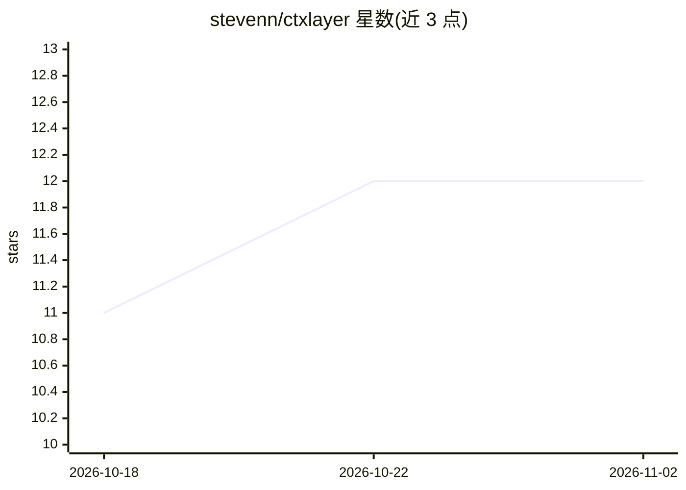

# stevenn/ctxlayer

⭐ 12 · TypeScript · MIT · 推送 2026-10-12 · [GitHub](https://github.com/stevenn/ctxlayer) · 个人维护

**部署在 Cloudflare Workers 的组织级 MCP 网关与文档上下文层**

自托管的 MCP 服务，运行于 Cloudflare Workers：以 Vectorize 支持的混合 RAG 检索提供组织 Markdown 文档与 search_docs 工具，原生读写 Open Knowledge Format（OKF）实现知识库导入导出；代理其他 MCP 服务器（HTTP/SSE 原生、stdio 需自带桥接），凭据 AES-GCM 加密存储；内置 React SPA 提供自助入驻、BlockNote+Yjs 协同编辑、上游管理与用量分析。面向为组织部署 MCP 基础设施的开发者/运维。限制：依赖 Cloudflare 资源（D1/KV/R2/Vectorize），Vectorize 无本地模拟器。

## 筛选速览

| 维度 | 判定 | 备注 |
|---|---|---|
| AI 角色 | `ai-ecosystem` | LLM/agent 周边工具 |
| 许可风险 | `permissive` | MIT |
| 部署形态 | `None` |  |
| 模型依赖 | — | README 未给出锁定关系 |
| 硬件要求 | — | 无带数字的原话,不猜 |
| 安装摩擦 | `low` | 无编译、无系统依赖或容器化 |
| 成熟度 | — | 结构信号不足 |

## 能力要点

- Vectorize 混合检索（稠密+词法、查询改写、重排序）的 search_docs 工具
- 代理上游 MCP 服务器，凭据 AES-GCM 加封、按团队/角色可见性与 ACL 控制
- 原生 OKF 导入/导出，文档库即 OKF bundle，支持 Git 双向同步与 PR 回写
- React SPA 自助入驻、协同编辑与用量审计分析

## 适用场景

- 为组织统一接入并管控多个 MCP 上游服务器
- 把组织文档做成可检索的 MCP 资源供 agent 调用
- 以 OKF 格式在组织间迁移与同步知识库

## 场景标签

`RAG` `知识库管理` · 领域:知识与检索

## 证据(README 行号)

> L16: - proxies other MCP servers (HTTP/SSE natively; a stdio MCP server is
> L67: - **MCP server** (`/mcp`, `/sse`) — built-ins (`search_docs`, `get_doc`,
> L71: - **Upstream proxy** — aggregate other MCP servers (Streamable HTTP / SSE;

## 星数曲线

2026-10-18 11 → 2026-11-02 12（+1）

---
*卡片 v1 · prompt 1.4 · 生成 2026-11-01 · 置信度 high · 依据 README sha `0c68cb9bbcf1` · [字段定义](../../DATASET.md)*
