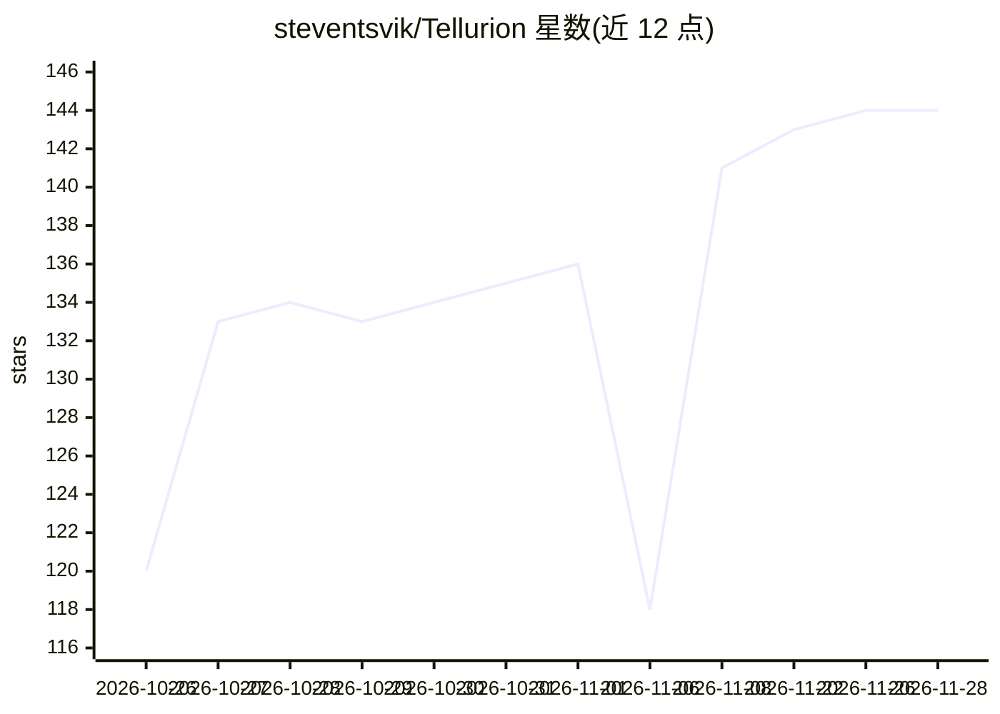

# steventsvik/Tellurion

⭐ 144 · Zig · AGPL-3.0 · 推送 2026-11-27 · [GitHub](https://github.com/steventsvik/Tellurion) · [官网](https://steventsvik.github.io/Tellurion/) · 个人维护

**在 macOS 终端中实时观测与管控多个 AI 编码 agent**

基于 Ghostty 的非官方 fork（AGPL-3.0），面向同时运行 Claude Code、Codex、Gemini CLI 等多个编码 agent 的开发者。提供 agent 侧栏实时状态、跟随 agent 编辑的代码编辑器、按回合快照的撤销、手机端远程审批、Mission Control、编排器（多 agent 分工）、agent 竞速、本地模型聊天等功能，追踪官方 Ghostty 发行并在其上叠加特性。要求 macOS 13+ 与 Apple silicon。

## 筛选速览

| 维度 | 判定 | 备注 |
|---|---|---|
| AI 角色 | `ai-ecosystem` | LLM/agent 周边工具 |
| 许可风险 | `viral` | AGPL-3.0 |
| 部署形态 | `desktop` | 安装包/桌面程序 |
| 模型依赖 | local-ok | 支持本地模型 |
| 硬件要求 | — | 无带数字的原话,不猜 |
| 安装摩擦 | `low` | 无编译、无系统依赖或容器化 |
| 成熟度 | — | 结构信号不足 |

## 能力要点

- 9 个 agent 实时状态上报，另按名称识别 8 个 agent
- 每回合快照，一键撤销 agent 的更改
- 手机经 Tailscale 访问终端并审批权限请求
- Orchestrator 用自有 agent 分工调度多个 agent

## 适用场景

- 同时管理多个项目里的编码 agent 并实时查看其改动
- 通过手机远程批准或拒绝 agent 的权限请求
- 让多个 agent 做同一任务并保留最佳结果

## 场景标签

`多智能体` `编码 Agent` · 领域:Agent 开发

## 证据(README 行号)

> L29: **Tellurion is a macOS terminal for developers who run several AI coding agents,
> L31: Ghostty, the fast native terminal, that shows what every agent is
> L75: of the others it finds on your Mac. Each hook only observes: it never approves, blocks or

## 星数曲线

2026-10-26 120 → 2026-11-28 144（+24）

---
*卡片 v1 · prompt 1.4 · 生成 2026-11-27 · 置信度 mid · 依据 README sha `94401a5f4139` · [字段定义](../../DATASET.md)*
