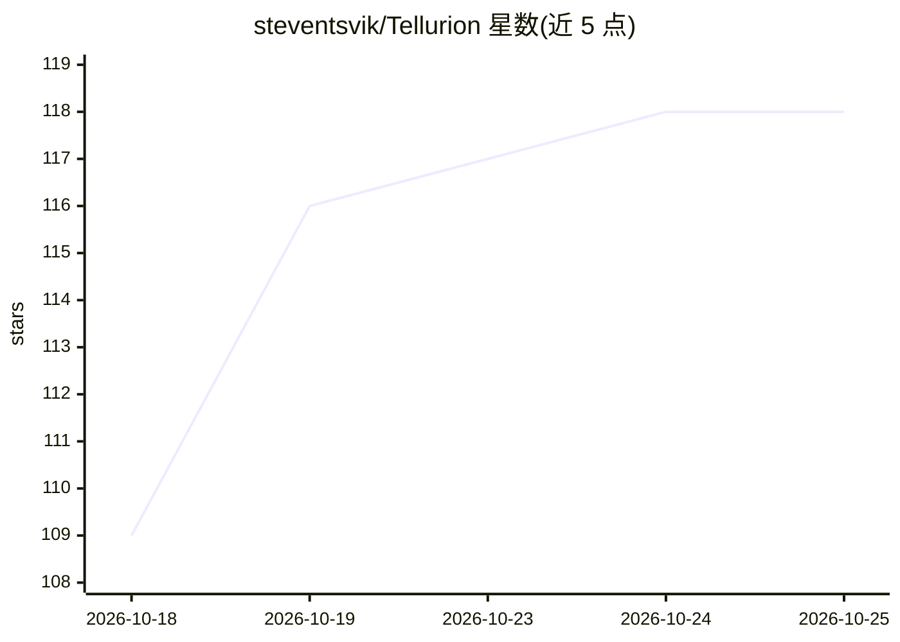

# steventsvik/Tellurion

⭐ 118 · Zig · AGPL-3.0 · 推送 2026-10-24 · [GitHub](https://github.com/steventsvik/Tellurion) · [官网](https://steventsvik.github.io/Tellurion/) · 个人维护

**面向多 AI 编码 agent 的 macOS 终端：实时观测、审查与撤销**

Ghostty 的非官方 fork，面向同时运行多个 AI 编码 agent（Claude Code、Codex、Gemini CLI 等 9 个上报实时状态，另有 8 个按名称识别）的开发者。提供 agent 侧边栏、Mission Control 总览、跟随 agent 编辑的 Monaco 编辑器、代码星图、项目记忆共享与 agent 间交接、每回合快照与撤销、审查收件箱与 agent 互相评审循环，以及通过 Ollama 的本地模型对话。兼容原 Ghostty 配置并跟踪其上游发布。限制：仅 Apple silicon、macOS 13+；hooks 只观测不改写 agent 行为。

## 筛选速览

| 维度 | 判定 | 备注 |
|---|---|---|
| AI 角色 | `ai-ecosystem` | LLM/agent 周边工具 |
| 许可风险 | `viral` | AGPL-3.0 |
| 部署形态 | `desktop` | 安装包/桌面程序 |
| 模型依赖 | local-ok | 支持本地模型 |
| 硬件要求 | — | 无带数字的原话,不猜 |
| 安装摩擦 | `low` | 无编译、无系统依赖或容器化 |
| 成熟度 | — | 结构信号不足 |

## 能力要点

- 9 个 agent 实时状态上报，权限提示可在卡片/通知中 Allow/Deny
- 每个回合前保存项目快照，可一键撤销任意回合
- Claude Code 与 Codex 的项目记忆可跨 agent 共享与交接
- 每标签页内置 Monaco 编辑器，实时跟随 agent 的读写与编辑

## 适用场景

- 同时跑多个 AI 编码 agent 时在一屏内掌握全部状态并处理权限请求
- 审查 agent 产出的 diff、行内评论并按回合撤销不满意的修改
- 把一个 agent 的工作与项目记忆移交给另一个 agent 继续

## 场景标签

`多智能体` `代码审查` · 领域:Agent 开发

## 证据(README 行号)

> L27: **Tellurion is a macOS terminal for developers who run several AI coding agents,
> L29: Ghostty, the fast native terminal, that shows what every agent is
> L68: Nine agents report live status: **Claude Code** and **Codex**, plus **GitHub Copilot CLI,

## 星数曲线

2026-10-18 109 → 2026-10-25 118（+9）

---
*卡片 v1 · prompt 1.4 · 生成 2026-10-23 · 置信度 mid · 依据 README sha `75752188fe0d` · [字段定义](../../DATASET.md)*
