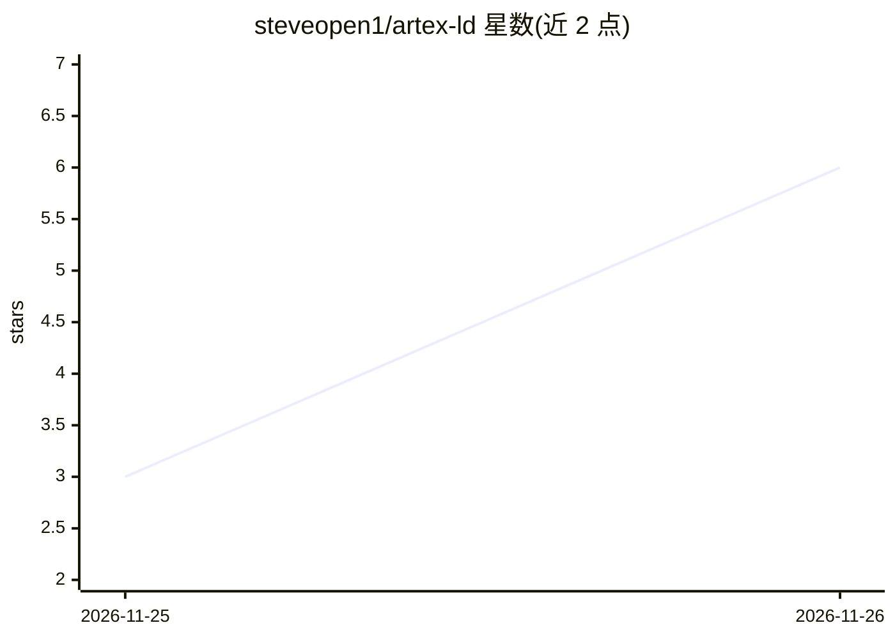

# steveopen1/artex-ld

⭐ 6 · Go · AGPL-3.0 · 推送 2026-11-25 · [GitHub](https://github.com/steveopen1/artex-ld) · 个人维护 · 中文 README

**给授权渗透测试者的 AI 自主渗透平台，输出证据级报告**

基于 ARTEX v0.3.15 二次开发的 AI 自主渗透测试平台，整合 RuoJi6/ARTEX 的调度治理（计划任务、worker 池、代理池、Finding 案例化）与 AntiFox 的证据驱动交付（复现过程落库、流量关联、截图、三语 docx 报告）。采用 planner-worker 双图架构自主派生意图并确认漏洞，支持 LLM 预审加人工批准的人在环路控制。提供 Release 部署包、Docker Compose、源码构建与预编译二进制四种部署方式，Web 界面运行于 8787 端口。

## 筛选速览

| 维度 | 判定 | 备注 |
|---|---|---|
| AI 角色 | `ai-native` | 本体是模型或模型工具 |
| 许可风险 | `viral` | AGPL-3.0 |
| 部署形态 | `self-host` | docker 或自建部署 |
| 模型依赖 | — | README 未给出锁定关系 |
| 硬件要求 | — | 无带数字的原话,不猜 |
| 安装摩擦 | `low` | 无编译、无系统依赖或容器化 |
| 成熟度 | — | 结构信号不足 |

## 能力要点

- planner-worker 双图架构自主派生意图、记录事实、确认漏洞
- 复现步骤逐字取自真实 MITM 录制流量，报告可跳转原始报文
- LLM 预审 + 人工批准/驳回的人在环路审批机制
- 三层能力整合：可控点配置、调度治理、证据驱动交付

## 适用场景

- 在隔离靶场对授权目标执行自主渗透测试
- 生成带复现流量与截图的三语交付级漏洞报告
- 通过知识库 RAG 约束 agent 的方法选择与判定标准
- 按日历计划任务批量调度渗透任务并治理重复 finding

## 场景标签

`RAG` `网络安全` · 领域:知识与检索

## 证据(README 行号)

> L5: 基于 ARTEX v0.3.15 的二次开发版本：AI 自主渗透测试平台。
> L74: 2. 在 **系统 → LLM** 配置模型（Anthropic / OpenAI / 兼容 OpenAI 的私有网关均可）。
> L95: - **planner-worker**：1 个 planner + N 个 worker goroutine 事件驱动推进，自主派生意图、记录事实、确认漏洞。

## 星数曲线

2026-11-25 3 → 2026-11-26 6（+3）

---
*卡片 v1 · prompt 1.4 · 生成 2026-11-24 · 置信度 mid · 依据 README sha `87876e116036` · [字段定义](../../DATASET.md)*
