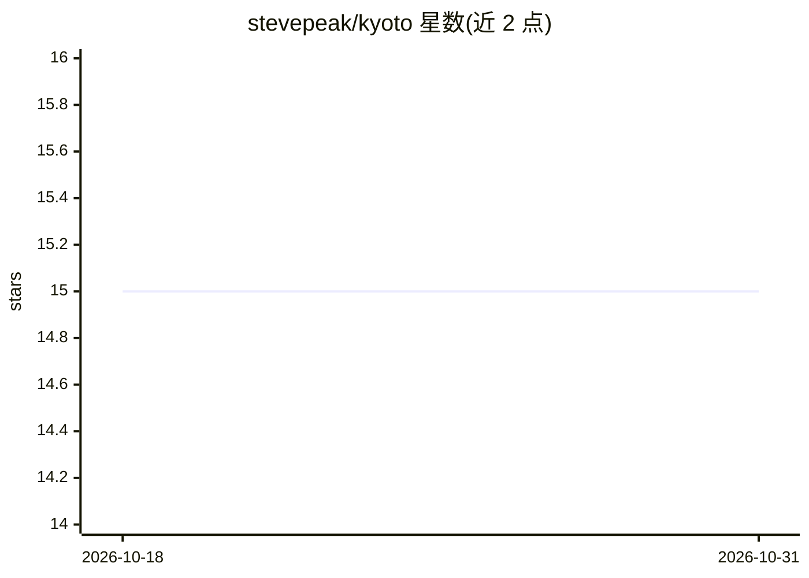

# stevepeak/kyoto

⭐ 15 · TypeScript · MIT · 推送 2025-12-29 · [GitHub](https://github.com/stevepeak/kyoto) · [官网](https://usekyoto.com) · 组织维护

**面向开发者的 vibe coding 代码检查与提交整理 CLI 工具**

命令行工具，面向采用 vibe coding 工作流的开发者：通过 `kyoto setup ai` 配置 AI 提供方与 API key 后，用 `kyoto vibe check` 检查暂存或全部变更中的问题（安全、死代码、重复函数等），用 `kyoto commit` 将未提交变更分析并组织为逻辑提交。另提供 MCP 服务接入、GitHub Action 集成、计划查看与文档命令，支持 GitHub OAuth 登录。每个检查 agent 默认超时 1 分钟。由 Codecov 创造者（@iopeak）维护。

## 筛选速览

| 维度 | 判定 | 备注 |
|---|---|---|
| AI 角色 | `ai-native` | 本体是模型或模型工具 |
| 许可风险 | `permissive` | MIT |
| 部署形态 | `None` |  |
| 模型依赖 | — | README 未给出锁定关系 |
| 硬件要求 | — | 无带数字的原话,不猜 |
| 安装摩擦 | `low` | 无编译、无系统依赖或容器化 |
| 成熟度 | — | 结构信号不足 |

## 能力要点

- vibe check 检查变更中的安全、死代码、重复函数等问题
- commit 命令将未提交变更组织为逻辑提交并生成提交信息
- 支持 MCP 服务与 GitHub Action 集成
- setup ai 配置 AI 提供方与 API key

## 适用场景

- 提交前检查 AI 生成代码引入的问题
- 把积压的未提交变更整理成有逻辑的分批提交
- 在 GitHub CI 中加入 Kyoto 检查

## 场景标签

`代码审查` · 领域:编码与开发

## 证据(README 行号)

> L13: 1. **Setup** Kyoto with `kyoto setup ai` to configure your AI provider and API key
> L14: 2. **Check** your changes with `kyoto vibe check` to test and diff user stories against staged changes
> L26: - `kyoto setup ai` - Configure your AI provider and API key

## 星数曲线

2026-10-18 15 → 2026-10-31 15（+0）

---
*卡片 v1 · prompt 1.4 · 生成 2026-10-30 · 置信度 mid · 依据 README sha `3f9495019dec` · [字段定义](../../DATASET.md)*
