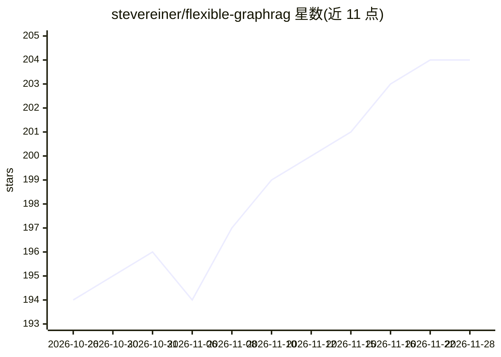

# stevereiner/flexible-graphrag

⭐ 204 · Python · Apache-2.0 · 推送 2026-11-21 · [GitHub](https://github.com/stevereiner/flexible-graphrag) · [官网](https://stevereiner.github.io/flexible-graphrag/) · 个人维护

**开源 GraphRAG/RAG 平台：文档接入知识图谱并支持混合检索与 AI 问答**

Python 后端（FastAPI REST 服务）+ React/Vue/Angular 前端 + MCP 服务器的 AI 上下文平台：通过 Docling/LlamaParse/LiteParse 解析文档，自动构建知识图谱，支持 RDF 本体，向 15 个属性图数据库、4 个 RDF 库、10 个向量库和 OpenSearch/Elasticsearch 写入，提供全文+向量+图+RDF 混合检索与 AI chat。LlamaIndex 为默认框架，LangChain 可按阶段选用；另支持 Langflow 可视化流与 CocoIndex 管线。14 种数据源（含 Alfresco/Nuxeo/SharePoint/Box/S3 等），其中 10 种支持增量自动同步，带权限感知检索。

## 筛选速览

| 维度 | 判定 | 备注 |
|---|---|---|
| AI 角色 | `ai-ecosystem` | LLM/agent 周边工具 |
| 许可风险 | `permissive` | Apache-2.0 |
| 部署形态 | `self-host` | docker 或自建部署 |
| 模型依赖 | local-ok | 支持本地模型 |
| 硬件要求 | — | 无带数字的原话,不猜 |
| 安装摩擦 | `low` | 无编译、无系统依赖或容器化 |
| 成熟度 | — | 结构信号不足 |

## 能力要点

- 3 条摄取管线（默认/CocoIndex/Langflow）共用同一数据源、目标库、UI 与 REST/MCP API
- 15 属性图 + 4 RDF + 10 向量 + 3 搜索库，各管线阶段可独立配置框架
- 14 种数据源，10 种支持增量自动同步（含 MS Graph delta 查询）
- Tauri/Rust 桌面应用支持本地文件/文件夹摄取与自动同步

## 适用场景

- 把企业文档库（SharePoint/Alfresco/Box 等）摄取为知识图谱并做问答
- 按权限只从用户可读的文档中检索和回答
- 需要同时写入多种向量/图/搜索数据库的一次性摄取
- 本地文件夹自动同步构建个人知识库

## 场景标签

`RAG` `知识图谱` · 领域:知识与检索

## 证据(README 行号)

> L30: **Flexible GraphRAG** is an open source AI context platform supporting a document processing pipeline (Docling, Lla
> L34: **New 11/10/26 — v0.10.0 release:** a **Graph tab** in the React, Vue and Angular UIs showing the entities and rela

## 星数曲线

2026-10-26 194 → 2026-11-28 204（+10）

---
*卡片 v1 · prompt 1.4 · 生成 2026-11-25 · 置信度 mid · 依据 README sha `b4d6d269afbf` · [字段定义](../../DATASET.md)*
