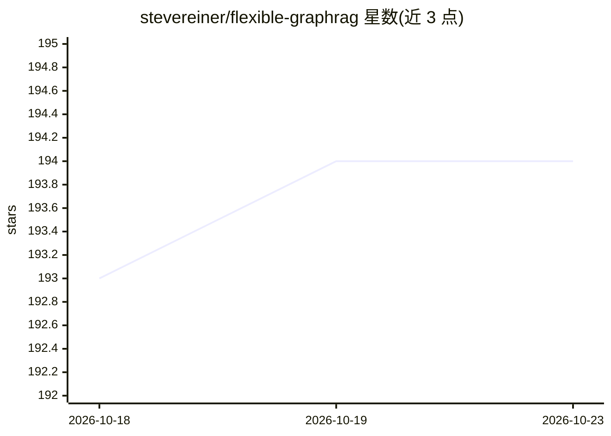

# stevereiner/flexible-graphrag

⭐ 194 · Python · Apache-2.0 · 推送 2026-10-21 · [GitHub](https://github.com/stevereiner/flexible-graphrag) · [官网](https://stevereiner.github.io/flexible-graphrag/) · 个人维护

**开源 AI 上下文平台：多数据源接入与 GraphRAG/RAG/混合检索/AI 问答**

面向需要企业内容问答与知识图谱检索的开发者和企业：Python 后端（FastAPI）配 React/Vue/Angular 前端与 MCP 服务器。核心机制为可配置的摄取管线（Docling/LlamaParse/LiteParse 解析，LlamaIndex 默认、LangChain 可按阶段替换），支持 14 种数据源（10 种增量自动同步，含 Alfresco、Nuxeo、SharePoint 等）、15 种属性图库、4 种 RDF 三元组库、10 种向量库与多种 LLM 提供商；另可选 Langflow 可视化流与 CocoIndex 管线。限制：数据源读取仅 LlamaIndex，部分图库仅单一框架支持。

## 筛选速览

| 维度 | 判定 | 备注 |
|---|---|---|
| AI 角色 | `ai-ecosystem` | LLM/agent 周边工具 |
| 许可风险 | `permissive` | Apache-2.0 |
| 部署形态 | `self-host` | docker 或自建部署 |
| 模型依赖 | local-ok | 支持本地模型 |
| 硬件要求 | — | 无带数字的原话,不猜 |
| 安装摩擦 | `low` | 无编译、无系统依赖或容器化 |
| 成熟度 | — | 结构信号不足 |

## 能力要点

- 15 种属性图库 + 4 种 RDF 三元组库 + 10 种向量库 + 3 种搜索引擎的混合检索
- 14 种数据源、其中 10 种支持增量自动同步（Alfresco/Nuxeo/SharePoint/Box 等）
- LlamaIndex 与 LangChain 双框架按管线阶段独立配置
- 提供 REST API、MCP 服务器与 React/Vue/Angular 三套前端，及权限感知搜索

## 适用场景

- 把企业内容仓库（Alfresco/Nuxeo/SharePoint）接入 GraphRAG 与 AI 问答
- 构建基于本体和知识图谱的混合检索（向量+全文+图+SPARQL）应用
- 需要数据源变更自动同步的知识库问答系统

## 场景标签

`RAG` `文档问答` `知识图谱` · 领域:知识与检索

## 证据(README 行号)

> L29: **Flexible GraphRAG** is an open source AI context platform supporting a document processing pipeline (Docling, Lla
> L63: - **Hybrid Search**: Configurable hybrid search combining vector search, full-text search, property-graph GraphRAG,
> L70: - **LLM providers (KG extraction & chat)**: Ollama, OpenAI, Azure OpenAI, Google Gemini, Anthropic Claude, Google V

## 星数曲线

2026-10-18 193 → 2026-10-23 194（+1）

---
*卡片 v1 · prompt 1.4 · 生成 2026-10-22 · 置信度 mid · 依据 README sha `1530a5bbddbe` · [字段定义](../../DATASET.md)*
