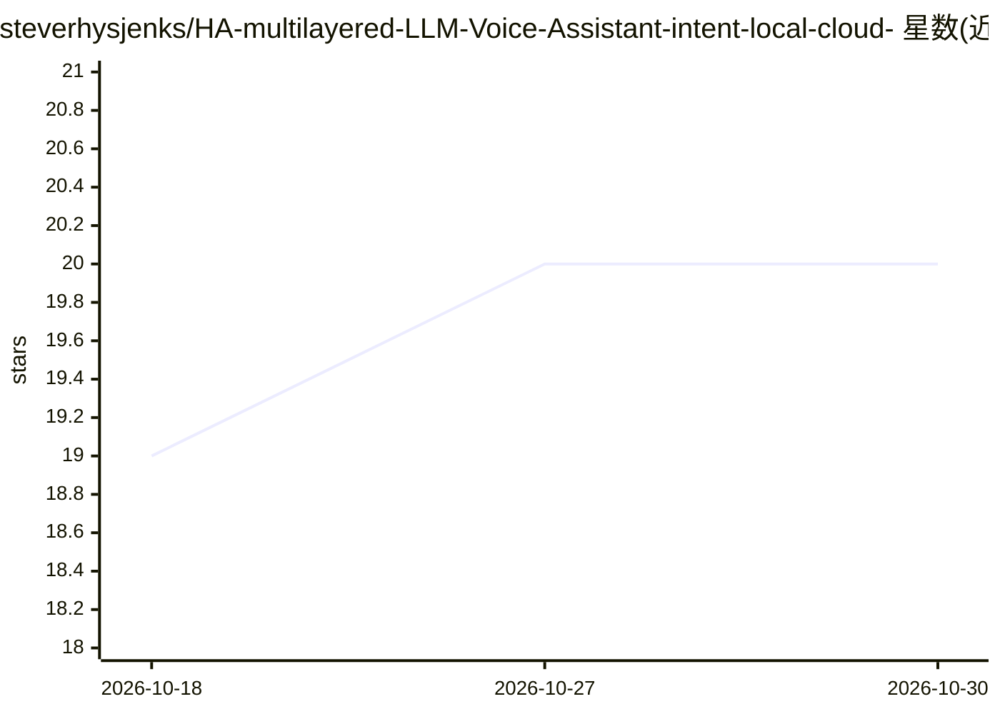

# steverhysjenks/HA-multilayered-LLM-Voice-Assistant-intent-local-cloud-

⭐ 20 · Python · MIT · 推送 2026-10-04 · [GitHub](https://github.com/steverhysjenks/HA-multilayered-LLM-Voice-Assistant-intent-local-cloud-) · 个人维护

**Home Assistant 语音请求的多 LLM 逻辑路由参考实现**

基于自定义 Python 路由器与 HA 自定义组件的语音请求分层路由：先由 Home Assistant 原生 intents 处理确定性指令，未命中的请求经 Qwen 小分类器判定 L/D/C 三类，分别路由到本地 Qwen 4B（经 LiteLLM/Ollama LXC）、桌面端 GPT-OSS 20B（Ollama，含 VRAM/模型驻留检查的 GPU 感知路由）或 OpenAI 云端兜底，再经 HA conversation agent 附带 HA 工具与实体。仓库提供配置示例、脚本、systemd 服务与 Windows GPU 状态脚本。

## 筛选速览

| 维度 | 判定 | 备注 |
|---|---|---|
| AI 角色 | `ai-ecosystem` | LLM/agent 周边工具 |
| 许可风险 | `permissive` | MIT |
| 部署形态 | `None` |  |
| 模型依赖 | local-ok | 支持本地模型 |
| 硬件要求 | — | 无带数字的原话,不猜 |
| 安装摩擦 | `low` | 无编译、无系统依赖或容器化 |
| 成熟度 | — | 结构信号不足 |

## 能力要点

- Qwen 分类器只做路由判定（L/D/C），不回答请求
- GPU/VRAM 感知路由：仅在桌面可安全运行时选择桌面大模型
- 四层路由：原生 intents → 本地小模型 → 桌面大模型 → 云端兜底
- 含 HA 自定义组件、脚本、systemd 单元与 GPU 状态 PowerShell 脚本

## 适用场景

- 自托管 Home Assistant 用户为语音请求分层选择本地/桌面/云端模型
- 在显存受限的桌面机上决定是否加载大模型回答
- 参考其架构搭建多 LLM 语音路由层

## 场景标签

`语音 Agent` `模型网关` · 领域:Agent 开发

## 证据(README 行号)

> L3: A practical reference implementation for routing Home Assistant voice requests across:
> L86: The classifier is intentionally small and cheap. It does **not** answer the request. It only chooses the next conve

## 星数曲线

2026-10-18 19 → 2026-10-30 20（+1）

---
*卡片 v1 · prompt 1.4 · 生成 2026-10-28 · 置信度 high · 依据 README sha `a2de64a6e525` · [字段定义](../../DATASET.md)*
