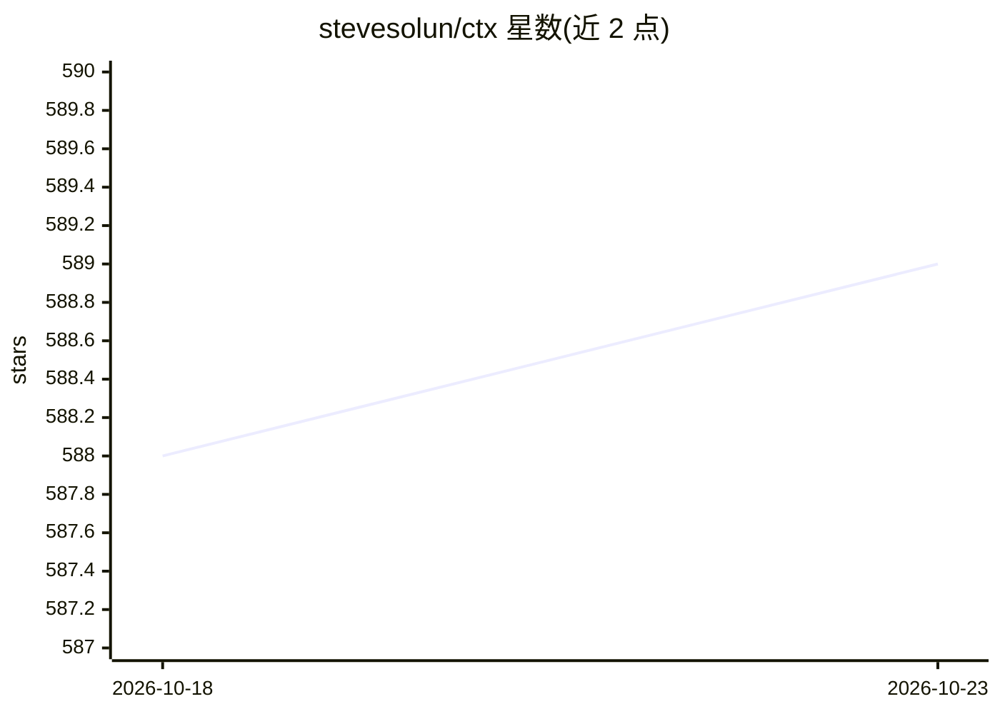

# stevesolun/ctx

⭐ 589 · Python · MIT · 推送 2026-10-14 · [GitHub](https://github.com/stevesolun/ctx) · [官网](https://stevesolun.github.io/ctx/) · 个人维护

**为仓库筛选最便宜且可靠的 AI 编码配置的 CLI 工具**

CTX Fit 分析仓库，从 git 历史导出代表性任务，在真实评测中测试候选 AI 编码能力配置，按固定规则选出结果：先剔除低于可靠性下限的候选，再最小化归因成本，平局时取更简单配置；LLM 只解释结果不决定结果。获胜配置可写入工作树（--apply）或以 PR 形式交付（--pr）。裸 ctx fit 免费、本地、只读、不跑模型；真实评测需 claude-ctx[harness]、Node.js/npx、provider 凭证，Linux 还需 Bubblewrap。不支持原生 Windows（建议 WSL2）。限制：仅在单一 harness 内比较配置，不跨 harness 对比。

## 筛选速览

| 维度 | 判定 | 备注 |
|---|---|---|
| AI 角色 | `ai-ecosystem` | LLM/agent 周边工具 |
| 许可风险 | `permissive` | MIT |
| 部署形态 | `library` | 以包/库形式分发 |
| 模型依赖 | — | README 未给出锁定关系 |
| 硬件要求 | — | 无带数字的原话,不猜 |
| 安装摩擦 | `low` | 无编译、无系统依赖或容器化 |
| 成熟度 | — | 结构信号不足 |

## 能力要点

- 固定规则选优：可靠性下限 → 最小归因成本 → 更简配置，LLM 不参与决定
- 裸 ctx fit 免费本地只读，不运行模型、不执行 git 写操作
- 获胜配置以可审查变更交付：--apply 写入 .ctx/fit-configuration.json 或 --pr 提交 PR
- 评测在禁网隔离环境运行，识别 Python/JS-TS/Go/Rust/Make 的原生验证命令

## 适用场景

- 为我的仓库找出成本最低且通过可靠性验证的 AI 编码配置
- 先免费 profile 仓库的 AI 编码就绪度，再决定是否花钱评测
- 把选出的配置以 PR 形式提交给团队审查

## 场景标签

 · 领域:开发者工具/AI 编码配置评测

## 证据(README 行号)

> L9: CTX Fit analyzes your repository, tests promising AI coding configurations
> L16: The winner is chosen by a fixed rule, not a score: discard every candidate

## 星数曲线

2026-10-18 588 → 2026-10-23 589（+1）

---
*卡片 v1 · prompt 1.4 · 生成 2026-10-22 · 置信度 high · 依据 README sha `36b57f6eb35c` · [字段定义](../../DATASET.md)*
