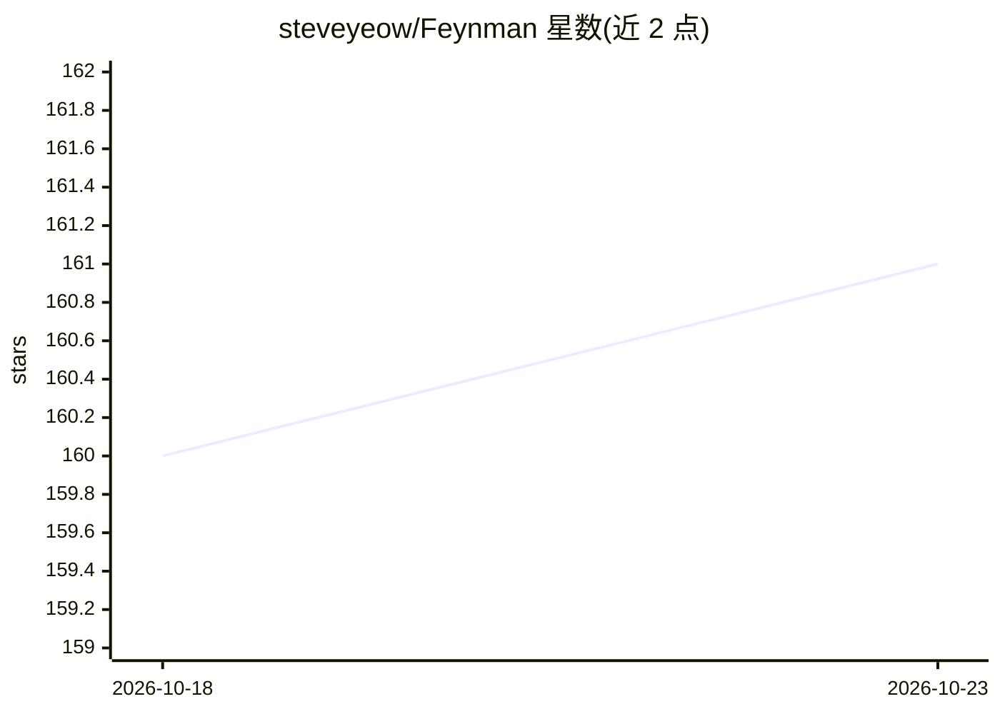

# steveyeow/Feynman

⭐ 161 · Python · NOASSERTION · 推送 2026-08-17 · [GitHub](https://github.com/steveyeow/Feynman) · [官网](https://feynman.wiki) · 个人维护

**与书籍和名家智能体对话的知识网络应用**

面向读书学习者的交互式知识网络应用：以书籍为节点，用户可与书籍对话（四层内容系统：RAG → Content Fetch → Web Search → LLM Knowledge），回答带可点击引用溯源；也可从主题出发，由 LLM 策展发现相关书籍并生成学习问题。特色是持续演化的 Great Minds 网络：AI agent 模拟学者、科学家等思想家自动加入对话并累积记忆，支持从 Twitter 主页、博客或文本上传自建 mind，内置 50+ 预生成人物与知识图谱可视化。技术栈含 Python/FastAPI，通过 git clone 源码运行；每次 LLM 调用实时显示 token 消耗。

## 筛选速览

| 维度 | 判定 | 备注 |
|---|---|---|
| AI 角色 | `ai-native` | 本体是模型或模型工具 |
| 许可风险 | `none` | NOASSERTION |
| 部署形态 | `None` |  |
| 模型依赖 | — | README 未给出锁定关系 |
| 硬件要求 | — | 无带数字的原话,不猜 |
| 安装摩擦 | `low` | 无编译、无系统依赖或容器化 |
| 成熟度 | — | 结构信号不足 |

## 能力要点

- 四层内容系统（RAG/Content Fetch/Web Search/LLM Knowledge）并带引用溯源
- agent 模拟的 Great Minds 自动加入对话并跨轮累积记忆
- 从 Twitter 主页、博客或文本上传自建 mind 人物
- 知识图谱力导向可视化，50+ 预生成人物

## 适用场景

- 读书前快速了解一本书是否值得深读
- 进入陌生领域时跨多本权威书籍构建知识框架
- 与模拟的名家一起讨论书籍内容与观点

## 场景标签

 · 领域:教育/阅读与知识网络

## 证据(README 行号)

> L7: An interactive knowledge network built on the world's most important books and great minds. With Feynman, you can ch
> L41: **1. Enter through a book** — Ask questions and get answers grounded in the work's actual content, with every claim
> L53: |1st|**RAG**|Retrieves relevant passages from the book's indexed content|
> L78: AI agents simulate these thinkers, faithfully capturing how they reason and argue, grounded in their actual works. 

## 星数曲线

2026-10-18 160 → 2026-10-23 161（+1）

---
*卡片 v1 · prompt 1.4 · 生成 2026-10-22 · 置信度 high · 依据 README sha `3ecc81184e2b` · [字段定义](../../DATASET.md)*
