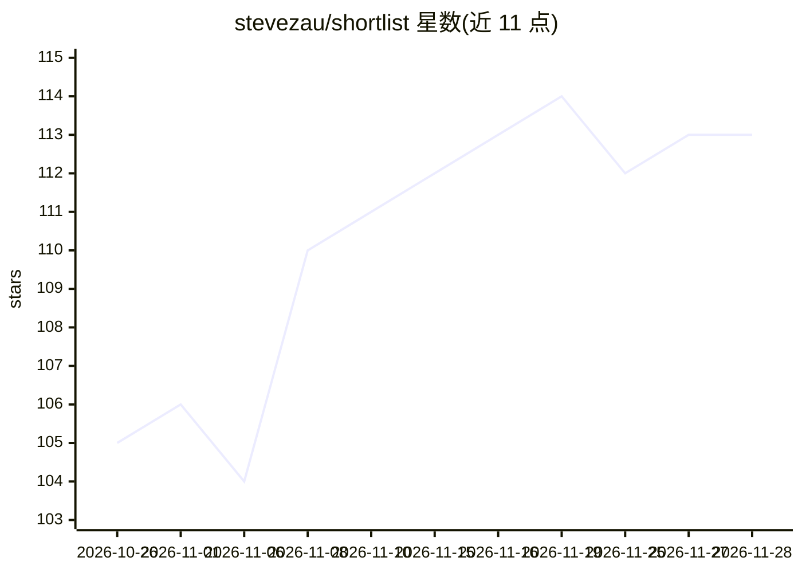

# stevezau/shortlist

⭐ 113 · Python · MIT · 推送 2026-11-23 · [GitHub](https://github.com/stevezau/shortlist) · [官网](https://shortlistapp.dev/) · 个人维护

**为 Plex 服务器每位用户生成私人推荐行的自托管工具**

Shortlist 读取每个 Plex 用户的观看历史，从本库中挑选未看过的影片，以带标签集合的形式发布为仅本人可见的 Home 推荐行（Picked for You、Because you watched 等），依赖 Plex 2026 年后标签隐藏机制保证隐私。核心排序与推荐理由由代码生成，无需 AI key；可选接入 AI 提供商做网络搜索补充候选或按描述生成主题行。仅容器部署，仅支持 Plex，需 Plex Pass 与 TMDB key。

## 筛选速览

| 维度 | 判定 | 备注 |
|---|---|---|
| AI 角色 | `ai-enhanced` | 去掉 AI 部分产品仍成立 |
| 许可风险 | `permissive` | MIT |
| 部署形态 | `self-host` | docker 或自建部署 |
| 模型依赖 | local-ok | 支持本地模型 |
| 硬件要求 | — | 无带数字的原话,不猜 |
| 安装摩擦 | `low` | 无编译、无系统依赖或容器化 |
| 成熟度 | — | 结构信号不足 |

## 能力要点

- 按用户观看历史生成仅本人可见的私人推荐行
- 推荐与理由由代码生成，推荐均为库内已验证存在的条目
- 可选 AI 提供商（Claude/GPT/Gemini/本地 Ollama 等）驱动网络搜索与 AI 行
- 支持对接 Radarr/Sonarr、Overseerr/Jellyseerr 补齐缺失片源

## 适用场景

- 家庭 Plex 服务器给每个成员生成各自的推荐行
- 把推荐行接入 Radarr/Overseerr 自动补片
- 用 AI 网络搜索补充 TMDB/Trakt 覆盖不到的新片

## 场景标签

`推荐系统` · 领域:学习与行业

## 证据(README 行号)

> L14:  Shortlist is a free, open-source, self-hosted tool that gives each person on your
> L43: **Shortlist gives every user their own rows.** For each person it reads their own Plex watch history,
> L100: - 🧠 **Picks that exist, with no AI key needed.** Every pick is a title verified to be in your library,
> L101:  never invented. Ranking and the reasons are written in code. An optional AI provider (Claude, GPT,

## 星数曲线

2026-10-26 105 → 2026-11-28 113（+8）

---
*卡片 v1 · prompt 1.4 · 生成 2026-11-28 · 置信度 high · 依据 README sha `7a69c6a3fe0f` · [字段定义](../../DATASET.md)*
