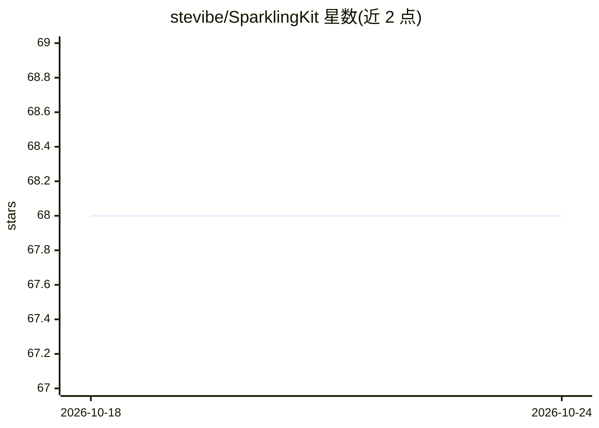

# stevibe/SparklingKit

⭐ 68 · TypeScript · Apache-2.0 · 推送 2026-09-02 · [GitHub](https://github.com/stevibe/SparklingKit) · [官网](https://sparklingkit.com) · 个人维护

**本地优先的 AI 工作台：OCR/转录/翻译/绘图/思维导图与可组合工作流**

面向私有工作站与家庭实验室的本地优先文件式 AI 工作区，提供 OCR、音频视频转录、翻译、视觉定位、文生图、交互式思维导图、聊天与节点式工作流编辑。本体不捆绑模型：连接独立部署的推理服务并按能力路由，参考部署在单台 DGX Spark（128GB 统一内存）上运行六个专用模型；也支持云端 API 与本地服务混配。以预构建容器加 Docker Compose 分发，处理历史以普通文件而非数据库保存。

## 筛选速览

| 维度 | 判定 | 备注 |
|---|---|---|
| AI 角色 | `ai-native` | 本体是模型或模型工具 |
| 许可风险 | `permissive` | Apache-2.0 |
| 部署形态 | `self-host` | docker 或自建部署 |
| 模型依赖 | — | README 未给出锁定关系 |
| 硬件要求 | — | 无带数字的原话,不猜 |
| 安装摩擦 | `low` | 无编译、无系统依赖或容器化 |
| 成熟度 | — | 结构信号不足 |

## 能力要点

- OCR/转录/翻译/视觉定位/文生图/思维导图/聊天七类模块，输出为带溯源的类型化工件
- 节点式工作流编辑器，支持条件、分支、合并与显式文件输出
- 参考部署在单台 DGX Spark 上运行六个专用模型，含更新与回滚脚本
- 本地优先：模型不捆绑，服务端点可自配，兼容本地与云端 API 混用

## 适用场景

- 在私有工作站上对会议录音做转录、摘要与追问
- 扫描 PDF 提取文本后翻译或问答，步骤间以工件衔接
- 文生图结果直接送视觉定位查找细节
- 把多步 AI 处理固化成可复用的工作流

## 场景标签

`工作流自动化` `图像生成` `OCR` `语音识别` · 领域:效率与自动化

## 证据(README 行号)

> L3: > A local-first, file-oriented AI workspace for OCR, transcription, translation, visual grounding, image generation,
> L12: SparklingKit’s reference deployment runs **six specialized models on a single NVIDIA DGX Spark with 128 GB of unifi
> L30: |Multimodal LLM|`nvidia/Qwen3.6-35B-A3B-NVFP4`|Chat, vision-aware references, summarization, and workflow prompts|

## 星数曲线

2026-10-18 68 → 2026-10-24 68（+0）

---
*卡片 v1 · prompt 1.4 · 生成 2026-10-24 · 置信度 mid · 依据 README sha `15a4f18d33a8` · [字段定义](../../DATASET.md)*
