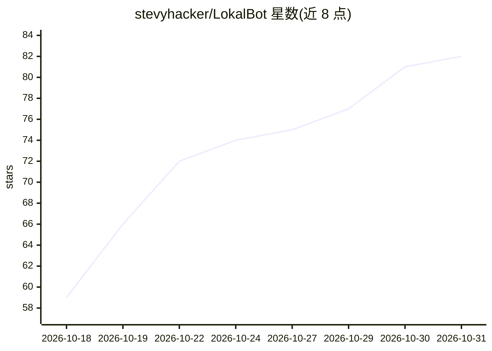

# stevyhacker/LokalBot

⭐ 82 · Swift · GPL-3.0 · 推送 2026-10-30 · [GitHub](https://github.com/stevyhacker/LokalBot) · [官网](https://www.lokalbot.com) · 个人维护

**本地运行的个人上下文引擎：会议记录、屏幕回忆、听写与自动补全**

面向个人用户的桌面应用，在用户电脑上录制会议音频（无机器人入会）并生成带引用的转录、摘要、决定与行动项；支持跨会议与屏幕内容的检索（关键词与语义）、任意应用内的句尾自动补全、按住快捷键的本地听写、选中文本改写，以及时间线工作会话回溯。内置本地小模型（Mac 用 Gemma 4 E2B，Windows/Linux 用 LFM2.5 1.2B），无账号、无遥测，数据存于本地 SQLite。附带只读 MCP 服务器与 CLI，供 Claude Code 等 agent 检索会议库。macOS 为正式版（Apple Silicon、macOS 15+），Windows/Linux 为 alpha。GPLv3。

## 筛选速览

| 维度 | 判定 | 备注 |
|---|---|---|
| AI 角色 | `ai-native` | 本体是模型或模型工具 |
| 许可风险 | `viral` | GPL-3.0 |
| 部署形态 | `desktop` | 安装包/桌面程序 |
| 模型依赖 | — | README 未给出锁定关系 |
| 硬件要求 | — | 无带数字的原话,不猜 |
| 安装摩擦 | `low` | 无编译、无系统依赖或容器化 |
| 成熟度 | `idea` | |

## 能力要点

- 无机器人入会的本地会议录制，产出带引用的转录/摘要/行动项
- 内置本地模型完成转录、语义搜索、自动补全与听写，无需 API key
- 附带只读 MCP 服务器与 lokalbot-cli，供外部 AI agent 检索
- 屏幕文本与截图为 opt-in 且默认 14 天过期

## 适用场景

- 不开会机器人就把会议内容转成可检索、带引用的笔记
- 回想起之前在屏幕上看到过的内容并跳转到对应时刻
- 在任意应用里用本地听写和句尾自动补全辅助写作

## 场景标签

`语音识别` `知识库管理` `语义搜索` `AI 写作` · 领域:内容生成

## 证据(README 行号)

> L7: Private meeting notes, workday recall, dictation, and autocomplete—with AI that runs on your computer.
> L39: Record microphone and meeting-app audio without a bot joining. Get local transcripts, recaps, decisions, and action
> L60: - **Stays on your computer.** A small model runs inside the app: Gemma 4 E2B on Mac, LFM2.5 1.2B on Windows and Lin

## 星数曲线

2026-10-18 59 → 2026-10-31 82（+23）

---
*卡片 v1 · prompt 1.4 · 生成 2026-10-24 · 置信度 high · 依据 README sha `c1de970ebed4` · [字段定义](../../DATASET.md)*
