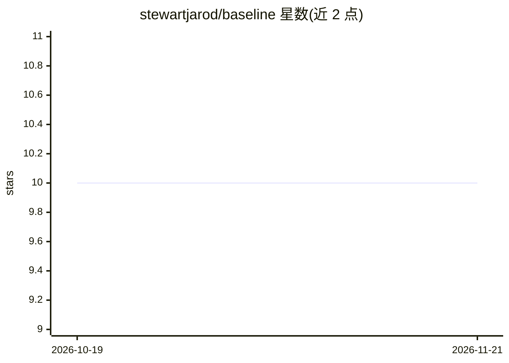

# stewartjarod/baseline

⭐ 10 · Rust · MIT · 推送 2026-02-18 · [GitHub](https://github.com/stewartjarod/baseline) · [官网](https://www.npmjs.com/package/code-baseline) · 个人维护

**约束 AI 生成代码的 CI 架构规则工具：禁用、棘轮与设计系统强制**

Rust 编写的单二进制 CI 工具，通过 baseline.toml 配置强制团队架构决策：禁止弃用依赖（解析 package.json）、禁止代码模式、要求文件存在、跨文件计数棘轮（上限只降不升）、Tailwind 暗色模式与 shadcn 语义 token 强制（130+ 默认映射）。定位覆盖 ESLint 未表达的规则类型，面向被 Cursor/Copilot/Claude 反复引入旧模式的团队。支持 presets、monorepo 目录级作用域与外部 TOML 插件。

## 筛选速览

| 维度 | 判定 | 备注 |
|---|---|---|
| AI 角色 | `ai-enhanced` | 去掉 AI 部分产品仍成立 |
| 许可风险 | `permissive` | MIT |
| 部署形态 | `library` | 以包/库形式分发 |
| 模型依赖 | — | README 未给出锁定关系 |
| 硬件要求 | — | 无带数字的原话,不猜 |
| 安装摩擦 | `low` | 无编译、无系统依赖或容器化 |
| 成熟度 | — | 结构信号不足 |

## 能力要点

- 5 种规则类型：banned-import/banned-pattern/required-pattern/banned-dependency/ratchet 等
- 棘轮机制：计数上限只降不升，CI 阻止增量迁移回退
- Tailwind 暗色模式与语义 token 规则，shadcn 感知
- Rust 单二进制、无 Node.js 运行时，支持 monorepo 目录级 preset

## 适用场景

- 阻止 AI 工具在 PR 中重新引入已弃用的依赖（如 moment.js）
- 用棘轮上限驱动 legacyFetch 等旧模式的增量清零
- 强制 shadcn 组件使用暗色模式与语义 token
- 在 monorepo 中对不同目录应用不同规则集

## 场景标签

 · 领域:开发者工具/代码质量

## 证据(README 行号)

> L12: A fast Rust-based CI tool that enforces bans, ratchets, and design system rules that ESLint can't express — so Curs
> L25: Linters catch syntax. Formatters fix whitespace. **baseline** enforces the decisions your team has already made — e

## 星数曲线

2026-10-19 10 → 2026-11-21 10（+0）

---
*卡片 v1 · prompt 1.4 · 生成 2026-11-19 · 置信度 high · 依据 README sha `4b54eb93d4e6` · [字段定义](../../DATASET.md)*
