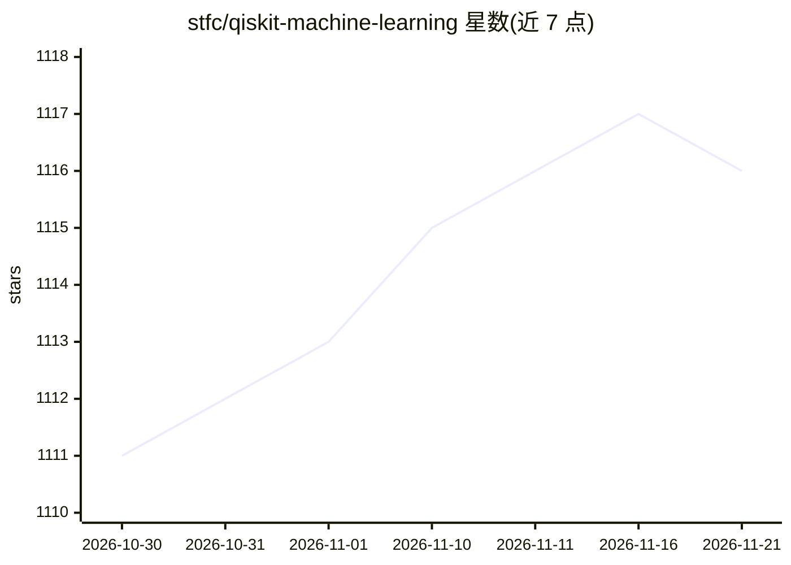

# stfc/qiskit-machine-learning

⭐ 1,116 · Python · Apache-2.0 · 推送 2026-11-19 · [GitHub](https://github.com/stfc/qiskit-machine-learning) · [官网](https://stfc.github.io/qiskit-machine-learning/) · 组织维护

**基于 Qiskit 的量子机器学习库：量子核与量子神经网络**

Qiskit Community 生态中的机器学习库，由 IBM 与英国 STFC Hartree Centre 共同维护（自 0.7 版起）。提供量子核方法（FidelityQuantumKernel，可配合 QSVC/QSVR 做分类与回归）与两种量子神经网络原语（EstimatorQNN、SamplerQNN），并配套 NeuralNetworkClassifier/Regressor 与高层 VQC/VQR 接口；通过 TorchConnector 与 PyTorch 集成实现混合量子-经典网络的自动微分。支持在量子硬件与经典模拟器上运行，经 pip 安装。

## 筛选速览

| 维度 | 判定 | 备注 |
|---|---|---|
| AI 角色 | `ai-native` | 本体是模型或模型工具 |
| 许可风险 | `permissive` | Apache-2.0 |
| 部署形态 | `library` | 以包/库形式分发 |
| 模型依赖 | — | README 未给出锁定关系 |
| 硬件要求 | — | 无带数字的原话,不猜 |
| 安装摩擦 | `low` | 无编译、无系统依赖或容器化 |
| 成熟度 | — | 结构信号不足 |

## 能力要点

- 量子核方法：FidelityQuantumKernel 计算 kernel 矩阵，配合 QSVC/QSVR
- 两种 QNN 原语：EstimatorQNN 与 SamplerQNN，含分类/回归学习算法
- TorchConnector 与 PyTorch 集成，支持自动微分
- 提供 pip 安装与可选的 PyTorch/Sparse/NLopt 附加安装

## 适用场景

- 在量子硬件或模拟器上训练量子分类与回归模型
- 构建混合量子-经典神经网络（PyTorch）
- 量子机器学习概念验证与研究原型

## 场景标签

`科研工具` · 领域:学习与行业

## 证据(README 行号)

> L16: Qiskit Machine Learning introduces fundamental computational building blocks, such as Quantum
> L20: This library is part of the Qiskit Community ecosystem, a collection of high-level libraries that are based

## 星数曲线

2026-10-30 1,111 → 2026-11-21 1,116（+5）

---
*卡片 v1 · prompt 1.4 · 生成 2026-11-19 · 置信度 high · 依据 README sha `8b0b3d218391` · [字段定义](../../DATASET.md)*
