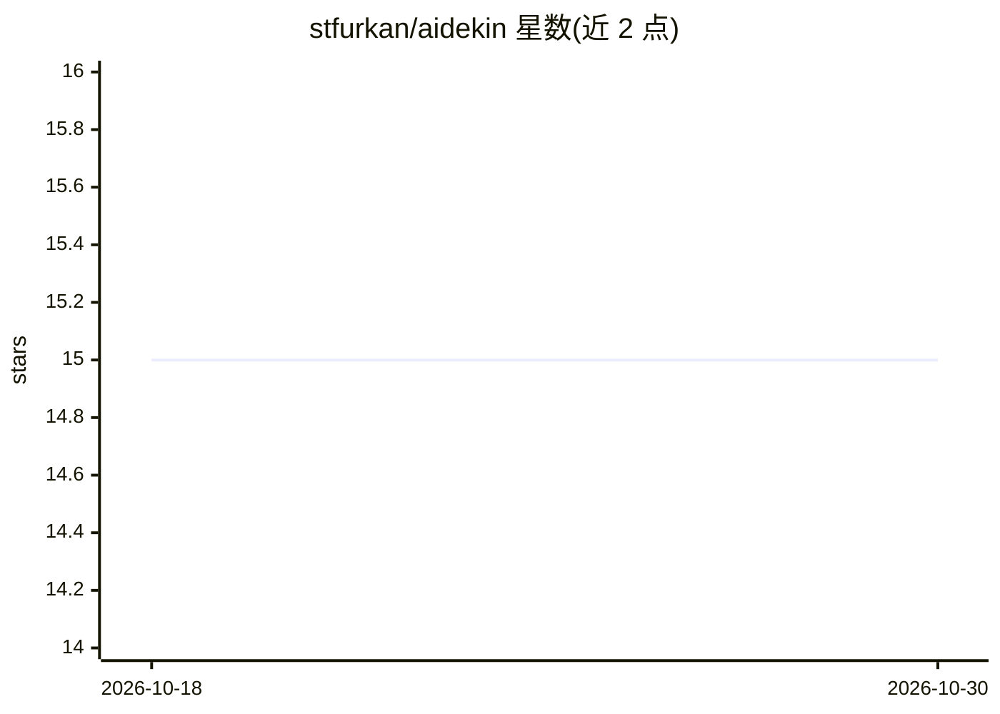

# stfurkan/aidekin

⭐ 15 · TypeScript · MIT · 推送 2026-09-29 · [GitHub](https://github.com/stfurkan/aidekin) · 组织维护

**一行脚本嵌入网站的浏览器内端侧语音+文本 AI 助手**

面向网站所有者的客户端 AI 助手挂件：粘贴一个 script 标签即可部署，语言模型、检索与语音识别/合成全部在访客浏览器内经 WebGPU 运行，无后端、无 API key、无按消息计费。LLM 为 1-bit 量化的 Bonsai-1.7B，运行于自研 bitgpu 引擎（约 0.5 GB VRAM），语音链路含 Silero VAD、Nemotron ASR 与 Supertonic TTS。支持用文档构建 knowledge.bin 做浏览器内 RAG。文本模式首次下载约 290 MB，语音模式额外约 1.6 GB，均缓存于本地；需要 WebGPU 浏览器。MIT 许可，支持自托管。

## 筛选速览

| 维度 | 判定 | 备注 |
|---|---|---|
| AI 角色 | `ai-native` | 本体是模型或模型工具 |
| 许可风险 | `permissive` | MIT |
| 部署形态 | `library` | 以包/库形式分发 |
| 模型依赖 | — | README 未给出锁定关系 |
| 硬件要求 | `gpu-8g` | |
| 安装摩擦 | `low` | 无编译、无系统依赖或容器化 |
| 成熟度 | — | 结构信号不足 |

## 能力要点

- 一个 script 标签嵌入，零构建步骤，无后端无 API key
- 自研 bitgpu WebGPU 运行时执行 1-bit LLM（约 0.5 GB VRAM）
- 浏览器内完成的 RAG：knowledge.bin 由网页工具或 CLI 构建
- 语音链路（VAD/ASR/TTS）按需懒加载，支持打断与流式朗读

## 适用场景

- 给自己的网站加一个不外发数据的 AI 问答挂件
- 在防火墙内或离线场景提供访客助手
- 用自家文档做知识库，让访客提问获得有出处的回答
- 自托管模型权重与挂件，完全脱离官方 CDN

## 场景标签

`AI 助手` `聊天机器人` `RAG` · 领域:对话与助手

## 证据(README 行号)

> L5: aidekin is an open-source, client-side AI assistant you drop onto any website. Your visitors get a private voice and
> L40:    VAD ─► Smart-Turn ─► ASR (Nemotron) ─► LLM (Bonsai-1.7B on bitgpu) ─► TTS (Supertonic)

## 星数曲线

2026-10-18 15 → 2026-10-30 15（+0）

---
*卡片 v1 · prompt 1.4 · 生成 2026-10-30 · 置信度 high · 依据 README sha `8f4bca6481fc` · [字段定义](../../DATASET.md)*
