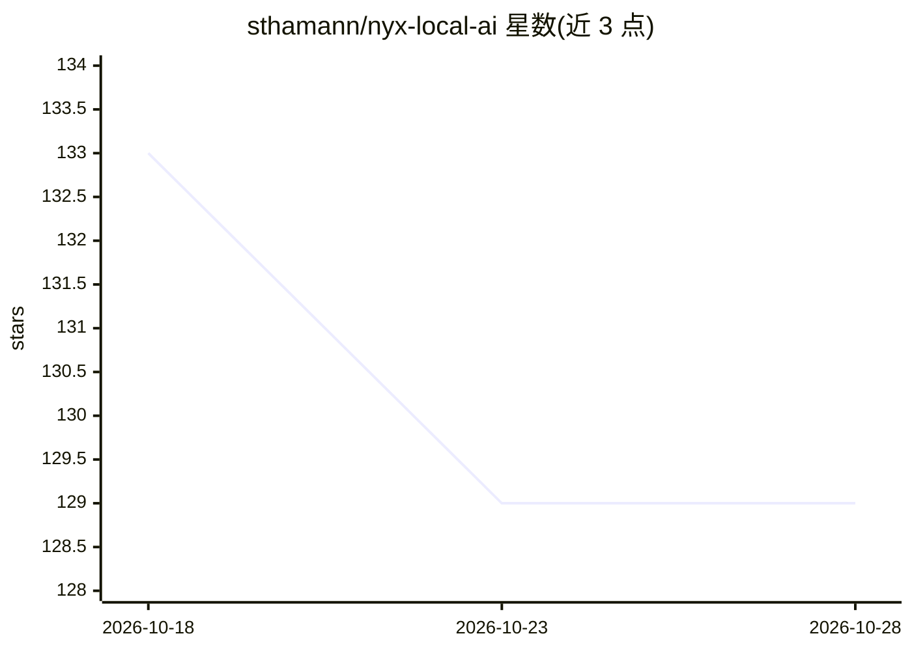

# sthamann/nyx-local-ai

⭐ 129 · TypeScript · MIT · 推送 2026-07-07 · [GitHub](https://github.com/sthamann/nyx-local-ai) · 个人维护

**面向本地推理的 VS Code/Cursor AI 编程代理扩展**

运行在 VS Code 与 Cursor 侧边栏中的本地优先编程代理：连接用户自有的推理端点（Ollama、LM Studio、llama.cpp、vLLM 等任何 OpenAI 兼容服务），自动发现模型、探测能力与上下文长度，并在多台机器间自动故障切换。提供 diff 审批卡、检查点、语义代码检索（本地嵌入索引）、MCP 工具、任务队列、Tab 补全、浏览器自动化等代理功能；针对本地小模型做了工具调用恢复与 JSON 修复。无账号、无遥测，可选联网仅限用户主动触发的抓取/搜索。

## 筛选速览

| 维度 | 判定 | 备注 |
|---|---|---|
| AI 角色 | `ai-ecosystem` | LLM/agent 周边工具 |
| 许可风险 | `permissive` | MIT |
| 部署形态 | `library` | 以包/库形式分发 |
| 模型依赖 | local-ok | 支持本地模型 |
| 硬件要求 | — | 无带数字的原话,不猜 |
| 安装摩擦 | `medium` | 含编译或系统依赖之一 |
| 成熟度 | — | 结构信号不足 |

## 能力要点

- 机器管理器：多 LAN 端点、按主机模型发现、能力探测与自动故障切换
- 针对不完美本地模型的工具调用恢复（OpenAI tool_calls/原始 JSON/DSML）与 JSON 修复
- 本地嵌入索引驱动的语义代码检索（nomic-embed-text，int8 量化）
- 隐私报告列出会话联系的所有主机，可核查无云端调用

## 适用场景

- 在自有硬件（Mac Studio/DGX 等）上离线运行 AI 编程代理
- 在 Cursor 中作为伴生面板处理需留在本机的任务
- 夜间批量队列执行多个编程任务并生成会话报告

## 场景标签

`编码 Agent` `浏览器自动化` · 领域:效率与自动化

## 证据(README 行号)

> L18: Nyx is that panel. A local-first coding agent in its own editor sidebar that
> L21: but every request goes to **your** machines. No account, no cloud, no telemetry,
> L52: - **Everything else** — ollama (`ollama pull qwen2.5-coder:32b`),

## 星数曲线

2026-10-18 133 → 2026-10-28 129（-4）

---
*卡片 v1 · prompt 1.4 · 生成 2026-10-22 · 置信度 mid · 依据 README sha `83724af0f5b3` · [字段定义](../../DATASET.md)*
