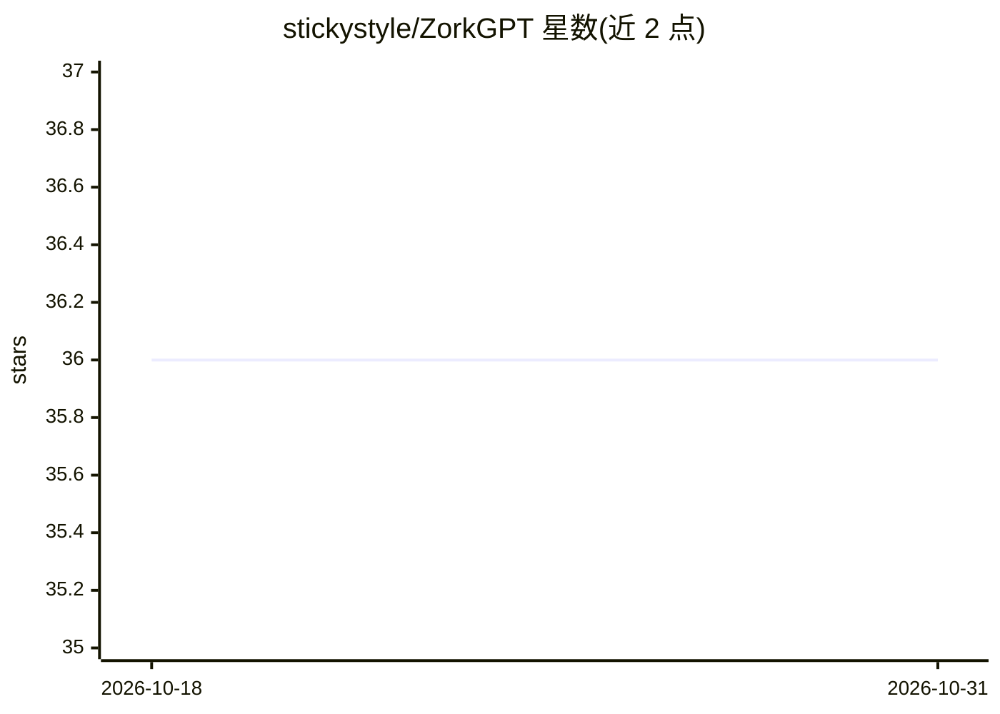

# stickystyle/ZorkGPT

⭐ 36 · Python · MIT · 推送 2026-04-05 · [GitHub](https://github.com/stickystyle/ZorkGPT) · 个人维护

**用 LLM 驱动 Agent 游玩文字冒险游戏 Zork 的研究系统**

面向 AI 研究者与开发者的实验系统：以纯 LLM 推理驱动 Agent 游玩经典文字冒险游戏 Zork，不预设任何谜题解法。架构含四个 LLM 认知模块（动作生成、混合信息抽取、动作评估、策略生成），通过 Jericho 库直接访问 Z-machine 内存获取位置/物品/分数等状态，配合动态地图、多层记忆与周期性知识合成（每 100 回合更新策略），实现数千回合的持续游玩与跨回合学习。需 Python 3.11+ 与 uv，从源码运行；作者声明已开始重写版本 ZorkGPT2 并在其上运行 live 演示。

## 筛选速览

| 维度 | 判定 | 备注 |
|---|---|---|
| AI 角色 | `ai-native` | 本体是模型或模型工具 |
| 许可风险 | `permissive` | MIT |
| 部署形态 | `None` |  |
| 模型依赖 | — | README 未给出锁定关系 |
| 硬件要求 | — | 无带数字的原话,不猜 |
| 安装摩擦 | `low` | 无编译、无系统依赖或容器化 |
| 成熟度 | — | 结构信号不足 |

## 能力要点

- 四个 LLM 认知模块：Agent/Extractor/Critic/Strategy Generator
- 经 Jericho 直接读取 Z-machine 内存，以整数位置 ID 实现移动精确检测
- 多层记忆层级：动作历史→位置记忆→策略知识→跨回合经验
- 每 100 回合的策略知识合成与知识库增量合并

## 适用场景

- 研究 LLM 在长程规划与空间推理任务中的能力
- 观察 LLM Agent 在交互式环境中的在线学习过程
- 作为文字游戏 Agent 的架构参考实现

## 场景标签

`模型评测` `Agent 框架` · 领域:Agent 开发

## 证据(README 行号)

> L3: # ZorkGPT: An LLM-Powered Agent for Interactive Fiction
> L13: ZorkGPT explores this question by demonstrating an AI agent system that plays the classic text adventure game "Zork
> L15: The research contribution lies in demonstrating that LLMs can develop authentic gameplay competence through a combi

## 星数曲线

2026-10-18 36 → 2026-10-31 36（+0）

---
*卡片 v1 · prompt 1.4 · 生成 2026-10-25 · 置信度 high · 依据 README sha `ee11c19c41c0` · [字段定义](../../DATASET.md)*
