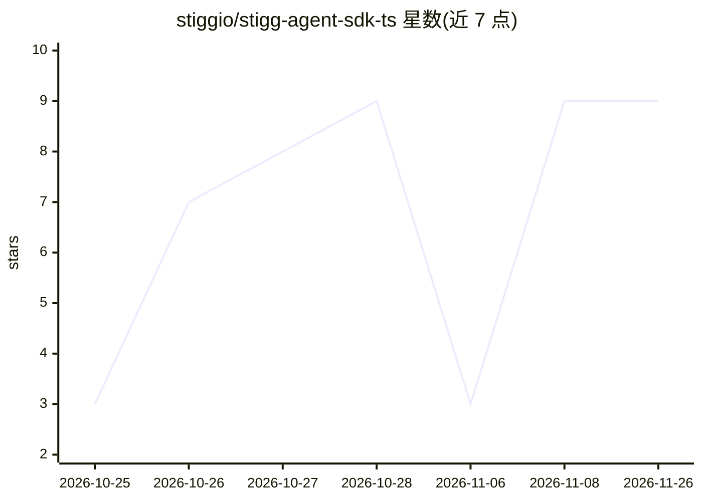

# stiggio/stigg-agent-sdk-ts

⭐ 9 · TypeScript · MIT · 推送 2026-11-10 · [GitHub](https://github.com/stiggio/stigg-agent-sdk-ts) · 组织维护

**为 agent 调用加用量治理的 SDK：调用前查额度、调用后计量**

面向 agent 开发者的 TypeScript 治理层：在模型调用前同步校验客户的权益/积分/预算，调用后异步上报实际用量，定价打包与计费交由 Stigg 平台处理。通过 wrap() 包装已有厂商客户端、wrapFetch 管控网关 HTTP 调用，并为 LangChain/LangGraph、Google ADK、Vercel AI SDK 提供回调处理器或插件；计量与强制执行分离，一个 fail-open、一个 fail-closed。各绑定按厂商返回数据的形状编写，安装本包不引入任何厂商 SDK 依赖，内置 mock 支持无 API key 运行示例。

## 筛选速览

| 维度 | 判定 | 备注 |
|---|---|---|
| AI 角色 | `ai-ecosystem` | LLM/agent 周边工具 |
| 许可风险 | `permissive` | MIT |
| 部署形态 | `library` | 以包/库形式分发 |
| 模型依赖 | local-ok | 支持本地模型 |
| 硬件要求 | — | 无带数字的原话,不猜 |
| 安装摩擦 | `low` | 无编译、无系统依赖或容器化 |
| 成熟度 | — | 结构信号不足 |

## 能力要点

- Check/Execute/Ingest 三段式：调用前权益检查、调用后异步计量
- 12 个 provider 与网关的治理绑定，且无一是依赖项
- wrap() 返回副本，原客户端保持不受治理；按客户端形状识别厂商
- 支持为每个 agent 注册独立预算，拒绝事件可携带预算信息

## 适用场景

- 为 SaaS 中按客户计费的 agent 调用加额度管控
- 在多 agent graph 中给每个子 agent 独立预算并处理拒绝
- 经网关路由的调用按实际计费模型与用量计量

## 场景标签

 · 领域:LLM 基础设施/计量计费

## 证据(README 行号)

> L5: Check a customer's entitlements, credits or budget **before** a model call, meter what the call
> L17: the engine seam. Twelve providers and gateways, **and not one of them is a dependency**.
> L66: A wrapper governs one client. A LangChain or LangGraph graph runs many agents and tools, so it

## 星数曲线

2026-10-25 3 → 2026-11-26 9（+6）

---
*卡片 v1 · prompt 1.4 · 生成 2026-11-20 · 置信度 high · 依据 README sha `72b20f159108` · [字段定义](../../DATASET.md)*
