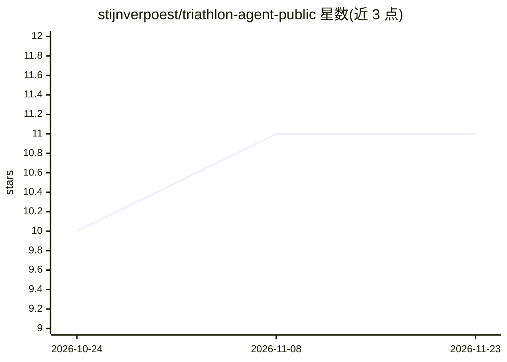

# stijnverpoest/triathlon-agent-public

⭐ 11 · Python · 推送 2026-10-20 · [GitHub](https://github.com/stijnverpoest/triathlon-agent-public) · 个人维护

**为铁三/跑步/越野跑者逐周制定训练计划的多 agent 教练工作流**

本地运行、按周规划的耐力运动教练工作流：由任意可执行 shell 命令与读写文件的 LLM coding agent 充当编排器，按顺序执行 Markdown 形式的专项教练提示词；仅用 Python 标准库的辅助层负责确定性工作——从 Intervals.icu 读取活动、HRV/静息心率/睡眠等数据，计算 CTL/TSB 负载、HRV 门控与进阶阶梯，按 Friel/Daniels/Coggan 准则对计划做审计，经用户批准后将结构化训练推回 Intervals.icu。支持 mock/live 两种模式，mid-week 可重排剩余天数。

## 筛选速览

| 维度 | 判定 | 备注 |
|---|---|---|
| AI 角色 | `ai-native` | 本体是模型或模型工具 |
| 许可风险 | `none` | — |
| 部署形态 | `None` |  |
| 模型依赖 | — | README 未给出锁定关系 |
| 硬件要求 | — | 无带数字的原话,不猜 |
| 安装摩擦 | `low` | 无编译、无系统依赖或容器化 |
| 成熟度 | — | 结构信号不足 |

## 能力要点

- 读取 Intervals.icu 活动、wellness（HRV/静息心率/睡眠）与赛事日历数据
- 编排器无关：兼容 Claude Code、OpenCode、Codex、Cursor 等任意 LLM coding agent
- finalize-run 按教练准则输出确定性审计报告
- 批准前不写回，批准与具体计划绑定，保留用户在 Intervals 中手动编辑的训练

## 适用场景

- 让 AI 教练逐周规划铁三/路跑/越野备赛训练
- 围绕 Intervals.icu 日历中的 A/B/C 赛事安排阶段与 taper
- 生病、出差或睡眠不佳后重排本周剩余训练

## 场景标签

`多智能体` · 领域:Agent 开发

## 证据(README 行号)

> L3: Local, on-demand endurance coaching workflow that plans one training week at a time for triathlon, road running and 
> L5: It is agent-agnostic: any LLM coding agent that can run shell commands and read and write files (Claude Code, OpenCo

## 星数曲线

2026-10-24 10 → 2026-11-23 11（+1）

---
*卡片 v1 · prompt 1.4 · 生成 2026-11-18 · 置信度 high · 依据 README sha `51d702ca0384` · [字段定义](../../DATASET.md)*
