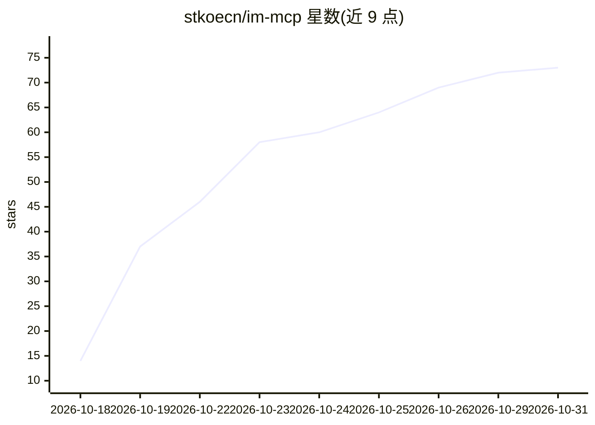

# stkoecn/im-mcp

⭐ 73 · Python · 推送 2026-10-22 · [GitHub](https://github.com/stkoecn/im-mcp) · [官网](https://github.com/stkoecn/im-mcp) · 个人维护 · 中文 README

**本地只读 MCP Server：让 AI Agent 检索微信与钉钉聊天记录**

基于 Model Context Protocol 的本地即时通讯聊天记录检索服务，支持微信 4.x/3.9.x 与钉钉 7.x（V2/V3）：从本地加密 SQLite 数据库离线解密（Windows 内存扫描 Salt 密钥 / macOS CommonCrypto、钉钉 PBKDF2 推导 AES 密钥），构建 FTS5 全文索引，供 Claude Desktop、Cursor、Cline、Pi 等 AI 客户端调用。微信侧提供 29 个只读工具（消息检索、通讯录、文件/图片/表情解密、活跃度统计、定时同步），钉钉侧提供 5 个工具。以 uv/uvx/pip 安装的 Python 包形式提供，附 CLI 初始化向导、Agent Skills 文档与一键清理工具。Windows 初始化需管理员权限并登录微信客户端。

## 筛选速览

| 维度 | 判定 | 备注 |
|---|---|---|
| AI 角色 | `ai-ecosystem` | LLM/agent 周边工具 |
| 许可风险 | `none` | — |
| 部署形态 | `desktop` | 安装包/桌面程序 |
| 模型依赖 | — | README 未给出锁定关系 |
| 硬件要求 | — | 无带数字的原话,不猜 |
| 安装摩擦 | `low` | 无编译、无系统依赖或容器化 |
| 成熟度 | — | 结构信号不足 |

## 能力要点

- 微信 29 个只读 MCP 工具 + 钉钉 5 个工具，覆盖消息检索、通讯录、文件图片解密与活跃度统计
- 纯本地离线运行，解密本地 SQLite 数据库并构建 FTS5 全文索引
- 按需安装：可只装微信、只装钉钉或全量安装
- 提供 wechat-init/dingtalk-init 一键初始化向导与 im-clean 一键清理工具

## 适用场景

- 在 Claude Desktop/Cursor 等 AI 客户端中搜索和总结微信/钉钉聊天记录
- 让 AI 汇总指定日期或时间范围的群聊沟通做日报周报
- 检索聊天中发送过的文件、图片与表情并解密提取
- 为群聊生成活跃度分析与成员画像

## 场景标签

`语义搜索` `文档问答` · 领域:知识与检索

## 证据(README 行号)

> L3: 基于 **Model Context Protocol (MCP)** 规范构建的本地 IM（绿泡泡 & DuangDuang）聊天记录与通讯录检索服务。
> L4: 极简、只读、完全离线本地运行，让 Claude Desktop、Cursor、Cline、Pi 等 AI Agent 能够安全、高速地检索与总结你的工作沟通、群聊记录和知识库。
> L32: ### 1. 绿泡泡 (`wechat-mcp`)

## 星数曲线

2026-10-18 14 → 2026-10-31 73（+59）

---
*卡片 v1 · prompt 1.4 · 生成 2026-10-24 · 置信度 high · 依据 README sha `66f6732803e9` · [字段定义](../../DATASET.md)*
