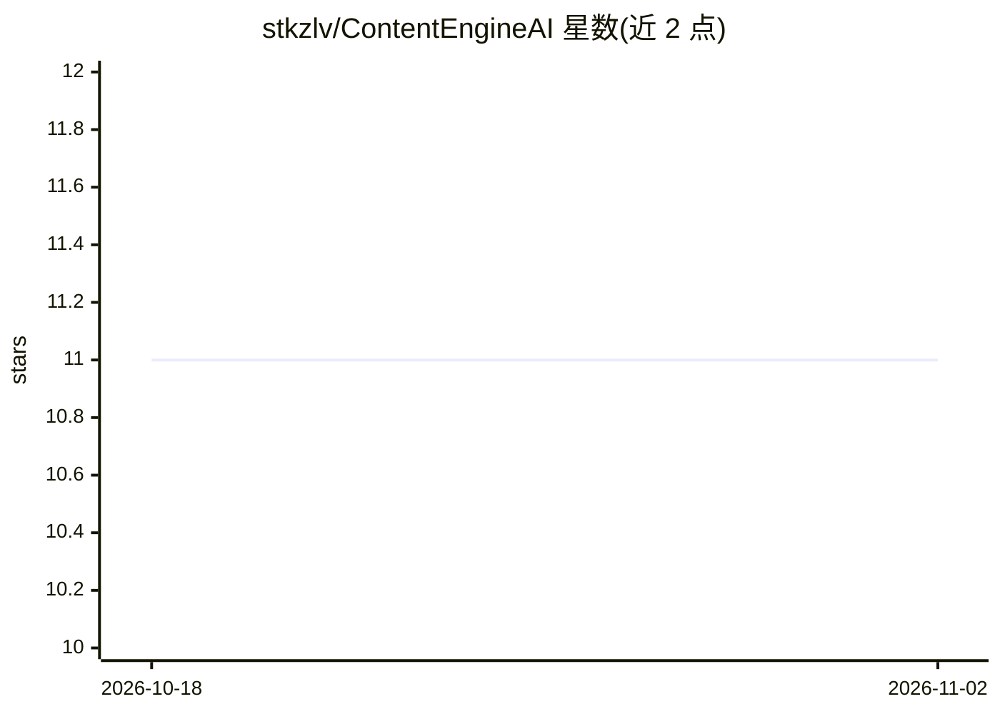

# stkzlv/ContentEngineAI

⭐ 11 · Python · MIT · 推送 2026-11-01 · [GitHub](https://github.com/stkzlv/ContentEngineAI) · 个人维护

**电商产品短视频自动化生产流水线，含抓取/配音/字幕/发布**

用 AI 生成电商产品竖版（9:16）推广视频的端到端流水线：从 Amazon 抓取商品数据，生成 AI 脚本、TTS 语音（Google Chirp 3 HD / Gemini TTS，Whisper 做同步）与内容感知字幕，产出各平台元数据，并通过调度器发布到 YouTube/TikTok/Instagram，附带联盟链接写入 bio 页、已发布商品登记与批量处理。以源码 checkout 方式运行（Poetry 管理），刻意不发布为 PyPI 包。状态标注为 Pre-Production。

## 筛选速览

| 维度 | 判定 | 备注 |
|---|---|---|
| AI 角色 | `ai-native` | 本体是模型或模型工具 |
| 许可风险 | `permissive` | MIT |
| 部署形态 | `library` | 以包/库形式分发 |
| 模型依赖 | — | README 未给出锁定关系 |
| 硬件要求 | — | 无带数字的原话,不猜 |
| 安装摩擦 | `medium` | 含编译或系统依赖之一 |
| 成熟度 | — | 结构信号不足 |

## 能力要点

- 抓取→脚本→配音→字幕→发布的完整自动化流水线
- Google Chirp 3 HD 与 Gemini TTS 配音，Whisper 做音画同步
- 含联盟披露（FTC/Amazon Associates/EU）与已发布商品 JSON/CSV 登记
- 批量处理数百商品，含平台特定标题/文案/话题标签生成

## 适用场景

- 我想批量给电商商品自动生成带货短视频
- 定时把产品视频发布到 YouTube/TikTok/Instagram 并自动加联盟链接
- 需要登记和追踪已发布商品的内容生产流程

## 场景标签

`网页抓取` `AI 写作` `语音合成` `工作流自动化` · 领域:效率与自动化

## 证据(README 行号)

> L10: **ContentEngineAI** is an AI-powered pipeline for generating short, vertical (9:16) promotional videos for e-commer
> L22: - **Premium Audio**: Google Chirp 3 HD and Gemini TTS voices with Whisper STT synchronization, channel-wide voice p

## 星数曲线

2026-10-18 11 → 2026-11-02 11（+0）

---
*卡片 v1 · prompt 1.4 · 生成 2026-11-01 · 置信度 mid · 依据 README sha `26b9bc0421ba` · [字段定义](../../DATASET.md)*
