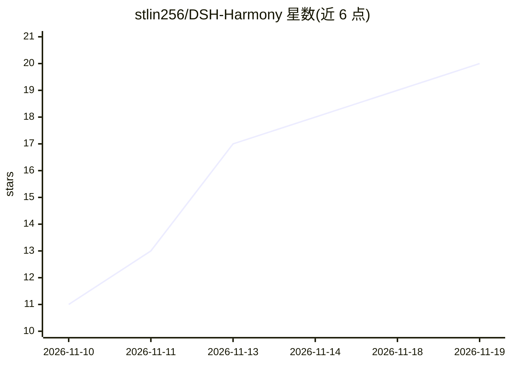

# stlin256/DSH-Harmony

⭐ 20 · TypeScript · AGPL-3.0 · 推送 2026-11-09 · [GitHub](https://github.com/stlin256/DSH-Harmony) · [官网](https://stlin256.github.io/DSH-Harmony/) · 个人维护 · 中文 README

**DeepSeek Harness 的 HarmonyOS 原生客户端应用**

以 ArkUI/ArkTS 构建的 HarmonyOS 7 手机/平板客户端，用于连接自建的 DeepSeek Harness 服务：提供会话、工具调用与实时输出、单次审批与风险确认、工作区文件只读预览、插件管理、自动化任务、HarmonyOS 通知与桌面服务卡片。通过 Releases 提供社区版 HAP 包，需用 hdc 安装并自行重签名；连接 DSH 还需安装配套插件 @dsh-harmony/plugin；登录支持 Harness 原生登录与 Passkey。AppGallery 版本准备中。

## 筛选速览

| 维度 | 判定 | 备注 |
|---|---|---|
| AI 角色 | `ai-ecosystem` | LLM/agent 周边工具 |
| 许可风险 | `viral` | AGPL-3.0 |
| 部署形态 | `None` |  |
| 模型依赖 | locked-api |  |
| 硬件要求 | — | 无带数字的原话,不猜 |
| 安装摩擦 | `low` | 无编译、无系统依赖或容器化 |
| 成熟度 | `idea` | |

## 能力要点

- ArkUI 原生会话界面与浮动任务计划、子代理谱系
- 单次审批、风险确认与贴输入栏的提问/附件交互
- HarmonyOS 分级通知、桌面服务卡片与 Push Kit 即时推送
- 通过发送指令让支持 plugin_manager 的 Agent 自动安装配套插件

## 适用场景

- 在鸿蒙手机/平板上使用自建的 DeepSeek Harness 工作流
- 移动端查看 agent 任务状态并通过通知回到会话
- 对高风险工具调用做单次审批与风险确认

## 场景标签

`AI 助手` `聊天机器人` · 领域:对话与助手

## 证据(README 行号)

> L21: DSH Harmony 将 DeepSeek Harness 的工作空间、会话、工具调用和实时输出带到 HarmonyOS，并以 ArkUI 构建为触控、键盘、安全区与系统返回重新设计的原生界面。

## 星数曲线

2026-11-10 11 → 2026-11-19 20（+9）

---
*卡片 v1 · prompt 1.4 · 生成 2026-11-18 · 置信度 high · 依据 README sha `e89085d417a4` · [字段定义](../../DATASET.md)*
