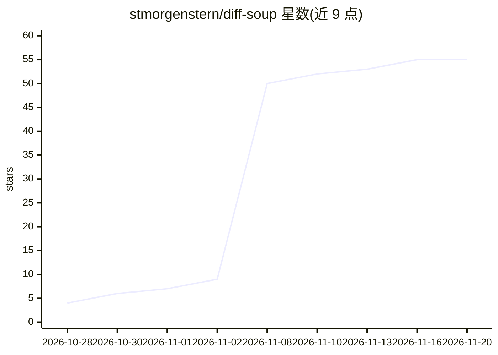

# stmorgenstern/diff-soup

⭐ 55 · Python · BSD-3-Clause · 推送 2026-11-19 · [GitHub](https://github.com/stmorgenstern/diff-soup) · [官网](https://stmorgenstern.github.io/diff-soup/) · 个人维护

**JAX 编写的可微分多物理场仿真与物理约束机器学习库**

基于 JAX 的科学计算软件包，用于 ODE/DAE/PDE 动态系统的建模、仿真与推断：提供类数学记法的 Recipe API、有限差分/有限体积/有限元离散化，以及自动微分加图着色组装的稀疏雅可比。仿真方面含三个 JAX 编写的刚性积分器（JNDF/JBDF/JIDA），支持 GPU 上的 cuDSS 稀疏直接求解、二阶正反模式微分与多 GPU 批量求解。推断方面支持参数估计（最小二乘/MLE/MAP）与将神经网络嵌入物理模型的可微分仿真。要求 Linux x86_64/aarch64 与 Python 3.12/3.13，GPU 需 NVIDIA 计算能力 8.0 以上。

## 筛选速览

| 维度 | 判定 | 备注 |
|---|---|---|
| AI 角色 | `ai-ecosystem` | LLM/agent 周边工具 |
| 许可风险 | `permissive` | BSD-3-Clause |
| 部署形态 | `library` | 以包/库形式分发 |
| 模型依赖 | — | README 未给出锁定关系 |
| 硬件要求 | `cpu-ok` | |
| 安装摩擦 | `medium` | 含编译或系统依赖之一 |
| 成熟度 | — | 结构信号不足 |

## 能力要点

- 三个 JAX 刚性积分器 JNDF/JBDF/JIDA 求解 ODE/DAE
- 自动微分加图着色组装稀疏雅可比，GPU 上 cuDSS 稀疏直接求解
- 每次求解支持二阶正反模式微分与多 GPU 批量并行
- 物理约束深度学习：神经网络嵌入物理模型内部

## 适用场景

- 求解刚性反应扩散等大规模动力系统并对其微分
- 基于可微分仿真做参数估计与物理约束训练神经网络
- 在 GPU 集群上批量运行多物理场仿真

## 场景标签

 · 领域:科学计算/多物理场仿真

## 证据(README 行号)

> L7: diff-soup is a software package written in JAX for modeling, simulation, and inference of (stiff) dynamical systems 
> L25: - physically-constrained deep learning using differentiable simulation, with neural networks embedded inside the ph

## 星数曲线

2026-10-28 4 → 2026-11-20 55（+51）

---
*卡片 v1 · prompt 1.4 · 生成 2026-11-18 · 置信度 high · 依据 README sha `27cc92d116a2` · [字段定义](../../DATASET.md)*
