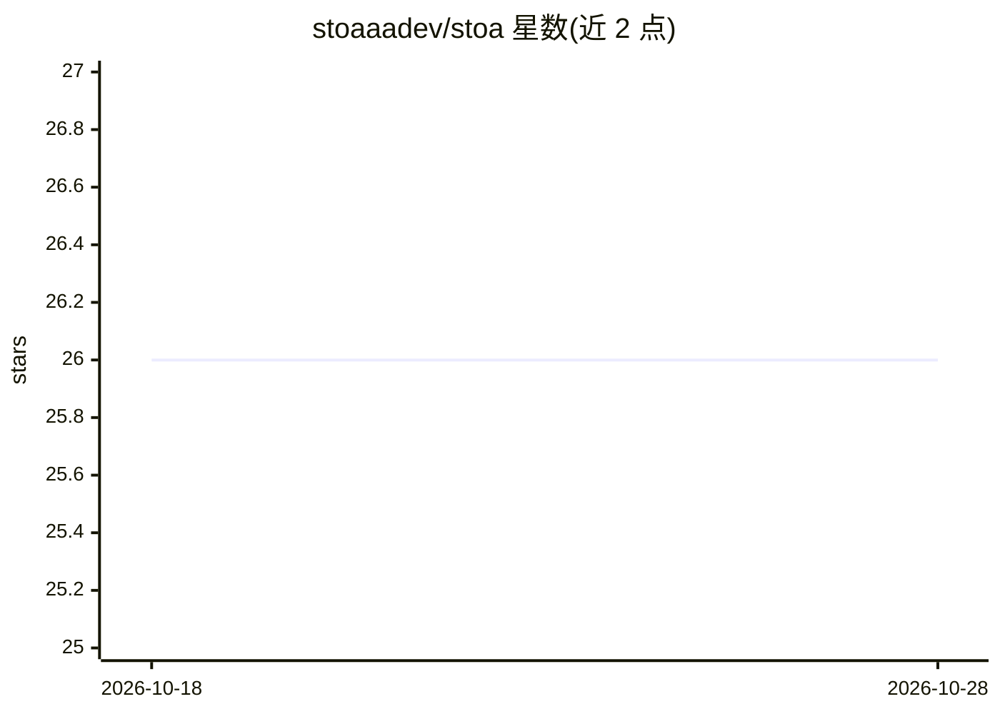

# stoaaadev/stoa

⭐ 26 · TypeScript · MIT · 推送 2026-05-20 · [GitHub](https://github.com/stoaaadev/stoa) · [官网](https://x.com/stoaframework) · 个人维护

**面向自主运行的多智能体群体框架，7 个 agent 共享 mesh 通信**

TypeScript 实现的多智能体群体框架：7 个分工 agent（侦察、分析、执行、守护、研究、写作、运维）通过基于 git 文件的 mesh 收件箱异步通信，能力以 markdown 技能文件定义，可组成带依赖图的技能链。默认在 GitHub Actions 上运行、状态存为 git 提交，含 Next.js 监控面板、Telegram/Discord/Slack 消息接入、Claude/OpenAI/Gemini 自动故障切换的 LLM 网关，以及 MCP Server 暴露给 Claude Desktop。默认配置包含 Solana 交易场景（可选），附 16 条安全机制说明。本地运行需 npm 安装，LLM API 调用产生费用。

## 筛选速览

| 维度 | 判定 | 备注 |
|---|---|---|
| AI 角色 | `ai-ecosystem` | LLM/agent 周边工具 |
| 许可风险 | `permissive` | MIT |
| 部署形态 | `library` | 以包/库形式分发 |
| 模型依赖 | locked-api |  |
| 硬件要求 | — | 无带数字的原话,不猜 |
| 安装摩擦 | `low` | 无编译、无系统依赖或容器化 |
| 成熟度 | — | 结构信号不足 |

## 能力要点

- 7 个角色化 agent 通过 mesh 协议（类型化 JSON 消息、TTL、确认）异步协作
- 技能为 markdown 提示文件，放入 skills/ 目录即被 agent 加载
- Claude→OpenAI→Gemini 三级自动故障切换的多 LLM 网关，可按 agent 配置模型
- GitHub Actions 上运行、git 提交存状态、无需服务器托管

## 适用场景

- 搭建自动运行的交易信号→分析→执行流水线（Solana 链上核验）
- 自动化研究、内容产出与仓库运维的多 agent 协作
- 通过 Telegram/Discord/Slack 向群体发消息并获回复
- 将群体作为工具接入 Claude Desktop（MCP Server）

## 场景标签

`多智能体` `Agent 框架` · 领域:Agent 开发

## 证据(README 行号)

> L17: stoa is a **multi-agent swarm** where seven specialized agents coordinate autonomously. Each agent has a role, a pe
> L275: stoa is a general-purpose multi-agent framework. The default config includes trading (scout → analyst → executor),

## 星数曲线

2026-10-18 26 → 2026-10-28 26（+0）

---
*卡片 v1 · prompt 1.4 · 生成 2026-10-26 · 置信度 high · 依据 README sha `8aa82048e578` · [字段定义](../../DATASET.md)*
